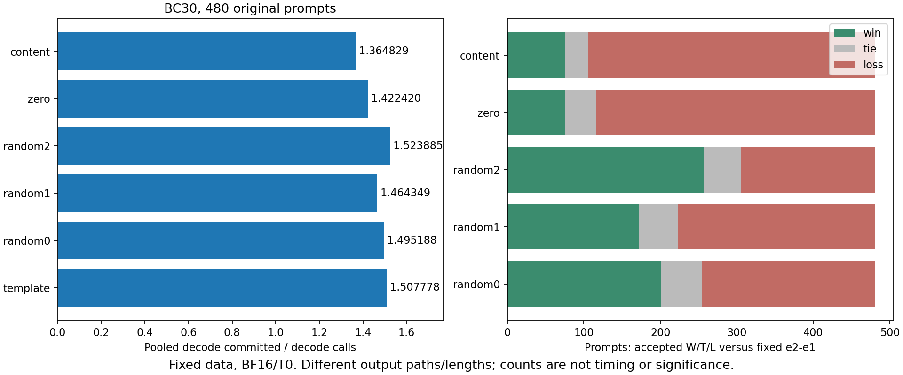

# 4B BF16 全480方向对照最终报告

当前步骤：BC30六格均完整480；五个新增完整路径原生成功，zero复用旧输入零阶，补齐Study process通过。
最新发现：random2 τ=1.523884714 > 固定e2−e1 1.507777653；content τ=1.364829262 < zero 1.422420206。
出处：[正式六格证据](../../studies/qwen3_4b_bf16_directions/docs/direction_evidence_v1.json)，所有数字均由该JSON重算；原始Run留本机。
下一步：完成CPU回归、PR22合dev并清理已合远程分支；本轮不追加BC60方向矩阵或新方法。
阻塞：无；GPU原队列自然exit0，数据/prompt未改，无测速。独立AR仅诊断，输出路径/长度不等。

## 一、固定设置与来源

本轮按[先冻结PLAN](../../studies/qwen3_4b_bf16_directions/docs/PLAN.md)执行；资源失败后的四格完整补齐见[补齐PLAN](../../studies/qwen3_4b_bf16_directions_recovery/docs/PLAN.md)。不是事后预注册。Qwen3-4B BF16/T0、原SpecBench全480及原顺序、原non-thinking模板/input_ids、seed123+index、最大256/EOS、BC30双mask/draft9动态剪枝，默认归约；λ0.1 updating mean、γ1、不normalize、不extrapolate_ema。输入数据SHA256为`7dd26882f31ada100c2aa7447019b5349bddc55697021acbc5643fdc8740aa21`。

| 方向组 | 定义及旧方法对应 |
| --- | --- |
| template | v始终固定e2−e1，只更新mean；不等于持续EMA更新的旧input_first |
| random0/1/2 | 预先指定种子0/1/2的固定高斯方向，FP32匹配template范数后转BF16；只更新mean |
| zero | v=0，复用旧30/input_zero完整480；不是ESP frozen mean |
| content | 从原首个user内容token开始的后缀初始化β0.9999速度，再原生EMA更新；保留全prompt mean，含后缀模板，不匹配范数 |

权重和forward为BF16；已有实现的FP32范数/EMA内部状态如实保留，未切FP32模型。本轮只做指定对照，未改prompt或主实验、未将优胜种子写回默认配方。全部方向完整prompt mean保存检查通过。

## 二、六格结果与数学门

τ主口径为Σdecode committed/Σdecode calls（不含prefill首token）；另列逐prompt均值、13个原始category各自pooled后等权均值。accepted沿用裁剪前计数，主calls含prefill；不据其差值声称等输出加速。

| 组 | pooled τ | prompt mean | category mean | accepted | 主calls | 新输出/argmax全过token | AR exact |
| --- | --- | --- | --- | --- | --- | --- | --- |
| template | 1.507777653 | 1.541530751 | 1.513855801 | 27,227 | 53,838 | 80,932 | 179/480 |
| random0 | 1.495188134 | 1.537621631 | 1.508771530 | 26,938 | 54,617 | 81,425 | 179/480 |
| random1 | 1.464349086 | 1.511211546 | 1.478840563 | 25,809 | 55,710 | 81,356 | 175/480 |
| random2 | 1.523884714 | 1.581027391 | 1.533153390 | 27,680 | 53,045 | 80,583 | 170/480 |
| zero | 1.422420206 | 1.479837486 | 1.430896407 | 23,926 | 56,938 | 80,787 | 168/480 |
| content | 1.364829262 | 1.431738497 | 1.392326359 | 21,540 | 59,313 | 80,777 | 181/480 |

表来源：正式JSON `cells[name].totals`；逐条question_id、输入合同、输出hash、首次AR分叉、新输出长度与计数见`rows`，来源/配置/运行环境/原始文件SHA见同一cell。正确性门为每个提交token等于该验证前向正确owner logits的argmax，含prefill，核对完整覆盖及hash/owner链；六格合计485,860个审计token全过，其中新增五格405,073，复用zero80,787。AR exact只有168–181/480，按授权仅作诊断，不是通过门。

| 组 | Study / Run | 状态 |
| --- | --- | --- |
| template | `studies/qwen3_4b_bf16_directions` / `1aa045b502c798f1` | succeeded |
| random0 | `studies/qwen3_4b_bf16_directions_recovery` / `2c3e7547a4f931a7` | succeeded |
| random1 | `studies/qwen3_4b_bf16_directions_recovery` / `5fec59e54de877eb` | succeeded |
| random2 | `studies/qwen3_4b_bf16_directions_recovery` / `95aff7e5e533a947` | succeeded |
| zero | `studies/qwen3_4b_bf16_five_methods/docs/paired_evidence_v1.json` / `e2fc2b6401860435` | succeeded |
| content | `studies/qwen3_4b_bf16_directions_recovery` / `bf2985a87c29fb29` | succeeded |

新增五格`source_digest=e963521adc8cb86f`，复用旧zero为`538e52c929a542a8`；科学文件的覆盖不以摘要猜测，实际清单以`source_refs_sha256`绑定的source_refs逐文件核对及读出断言为准。两Study的control原文一致，全部spec/eval/seed/model/runtime合同核对通过。原Study complete=true、passed=false（四资源失败保留）；补齐Study complete=true、passed=true。最终JSON只组合原成功template、四个新的完整成功Run及旧成功zero，既不拼接partial，也不改签失败Run。

## 三、逐prompt配对

以下第二组相对第一组：accepted更高为胜、主calls更低为胜、τ更高为胜。τ用整数交叉乘积判断平局，所有格各480；输出不等长。

| 第一组→第二组 | accepted胜/平/负 | calls胜/平/负 | τ胜/平/负 | Δaccepted | Δcalls | Δ新输出 |
| --- | --- | --- | --- | --- | --- | --- |
| template→random0 | 201/53/226 | 186/51/243 | 195/46/239 | -289 | +779 | +493 |
| template→random1 | 172/51/257 | 168/47/265 | 164/45/271 | -1,418 | +1,872 | +424 |
| template→random2 | 257/48/175 | 257/53/170 | 267/47/166 | +453 | -793 | -349 |
| template→zero | 76/40/364 | 104/20/356 | 78/19/383 | -3,301 | +3,100 | -145 |
| template→content | 76/29/375 | 92/32/356 | 73/28/379 | -5,687 | +5,475 | -155 |

表来源：`vs_template`。相对旧五方法的全部30组配对如下，对应`vs_existing_five`；不是新增五方法主表。

| 旧BC30方法→方向 | accepted胜/平/负 | calls胜/平/负 | τ胜/平/负 |
| --- | --- | --- | --- |
| 30/frozen_mean→template | 299/38/143 | 286/34/160 | 294/28/158 |
| 30/input_zero→template | 364/40/76 | 356/20/104 | 383/19/78 |
| 30/input_first→template | 104/236/140 | 110/234/136 | 105/229/146 |
| 30/output_zero→template | 334/36/110 | 326/37/117 | 341/33/106 |
| 30/output_first→template | 329/39/112 | 328/38/114 | 342/34/104 |
| 30/frozen_mean→random0 | 300/23/157 | 278/26/176 | 296/23/161 |
| 30/input_zero→random0 | 363/29/88 | 333/28/119 | 360/27/93 |
| 30/input_first→random0 | 191/54/235 | 184/49/247 | 183/47/250 |
| 30/output_zero→random0 | 326/35/119 | 305/33/142 | 335/32/113 |
| 30/output_first→random0 | 326/34/120 | 302/38/140 | 339/28/113 |
| 30/frozen_mean→random1 | 275/22/183 | 261/29/190 | 269/25/186 |
| 30/input_zero→random1 | 308/25/147 | 292/30/158 | 306/28/146 |
| 30/input_first→random1 | 178/41/261 | 170/38/272 | 167/36/277 |
| 30/output_zero→random1 | 276/50/154 | 268/48/164 | 280/43/157 |
| 30/output_first→random1 | 269/44/167 | 265/39/176 | 273/36/171 |
| 30/frozen_mean→random2 | 346/27/107 | 344/29/107 | 343/25/112 |
| 30/input_zero→random2 | 384/23/73 | 383/19/78 | 401/17/62 |
| 30/input_first→random2 | 257/43/180 | 257/53/170 | 263/46/171 |
| 30/output_zero→random2 | 377/25/78 | 368/26/86 | 385/24/71 |
| 30/output_first→random2 | 361/36/83 | 369/29/82 | 385/27/68 |
| 30/frozen_mean→zero | 229/24/227 | 235/21/224 | 234/19/227 |
| 30/input_zero→zero | 0/480/0 | 0/480/0 | 0/480/0 |
| 30/input_first→zero | 81/35/364 | 104/24/352 | 83/19/378 |
| 30/output_zero→zero | 211/38/231 | 210/34/236 | 218/31/231 |
| 30/output_first→zero | 207/42/231 | 212/36/232 | 216/32/232 |
| 30/frozen_mean→content | 198/28/254 | 197/30/253 | 194/27/259 |
| 30/input_zero→content | 154/28/298 | 167/29/284 | 152/23/305 |
| 30/input_first→content | 76/28/376 | 95/34/351 | 76/29/375 |
| 30/output_zero→content | 137/40/303 | 148/40/292 | 139/34/307 |
| 30/output_first→content | 130/40/310 | 151/40/289 | 139/36/305 |

旧主方法pooled τ仍为ESP frozen mean1.402894760、输入零阶1.422420206、输入一阶1.511957584、输出零阶1.433178245、输出一阶1.435539512；BC60的对应五方法已完成，数值仍见[阶段报告](sd-stage-report-2026-10-15.md)与[旧正式证据](../../studies/qwen3_4b_bf16_five_methods/docs/paired_evidence_v1.json)。不能拿新固定template替代旧input_first。

## 四、结论与解释边界

事实：三个预定同范数随机方向的pooled τ都高于zero；random0/1低于template，random2高于template和旧原生input_first。random2对zero的逐promptτ为401胜/17平/62负；content对zero为152/23/305，accepted154/28/298。结论是不支持本批“收益只能来自由value算出的e2−e1方向”；固定模板方向也不是这三个预定随机方向中的必然最优。各随机种子全部保留，不挑random2另立主方法，不证明任意方向有效。

content初始化范数比（相对template）最小/均值/最大为0.591236532/1.383690144/1.707526207，cosine为−0.166161716/0.010649421/0.161899179；来源`cells.content.direction_rows`全480的标量分布。随机0/1/2实际BF16范数比分别0.999963522/1.000066400/1.000049949，cosine分别0.030544994/0.014653734/−0.046994805。content改变方向、幅度、初始化和后续更新，不能从其负结果单独认定内容无用或范数是原因；当前未隔离这些因素，不自动发明新消融。

原生输入一阶相对输出方法的差距仍存在，先前局部双向窗口提供可逆接受翻转，但本轮没有把输出hidden空间与输入embedding空间的差距归因到唯一机制。同一模型/预算/T0及三个固定随机方向不能支持跨模型或任意方向泛化。480条为共享评价输入，不是独立训练重复；未做显著性或测速结论。

## 五、实际成本、BC60决定与交付

新增五个有效完整格共2,400次prompt执行、405,073个新输出token和276,523次主模型调用；复用zero480条、80,787 token/56,938 calls不计新增成本。资源失败的105次完整prompt执行另消耗20,977个审计token、13,854次模型调用，见[资源事件证据](../../studies/qwen3_4b_bf16_directions/docs/resource_interruptions_v2.json)。有效新增加已知完整partial计426,050 token、290,377 calls；partial未覆盖的加载/未完成forward不假装已统计。本报告不给墙钟或吞吐测速。

BC60方向本轮不追加。理由：用户安排是先完成BC30再按实际工作量决定；三随机方向全量已足以否定本批方向唯一性，而重复五个BC60新格至少再增2,400次prompt执行，回答的是跨预算泛化，无法解决content范数混杂或输出空间归因。已有主五方法BC60完整保留；本次明确只完成方向BC30，不声称方向BC60已验证。新idea和新实验待Enmao指示。

量化v3按组间窗口完成一次实际交接后，原SD队列恢复并自然完成content；GPU准入只看实际nvidia-smi。无重叠SD队列、无故意挂起的遗留进程，未杀外部作业。详细交接见[补齐报告](../../studies/qwen3_4b_bf16_directions_recovery/docs/STUDY_REPORT.md)。

本轮沿用用户长期授权：正常commit/push、PR合dev及合后删除远程已合工作分支；不合main、不force push、不删本地数据/分支。研究计划已通过PR23；本报告及正式证据通过PR22交付，最终CI/merge与远程清理以PR记录为准，不预写已完成。

CPU验证：`python -m pytest tests/spec_mtp --basetemp=.tmp/final-directions-tests-20261016 -q`完整通过（exit0）；一个第三方原码SyntaxWarning保留。`ruff check src tests studies tools`与mypy（56个源文件）通过。正式JSON两次读出字节一致，SHA256为`e157ab5ed9fa0721681da3fd68b842ec6d9d1aa1dcb5923499f66540eca36bab`；图已实际检查，中英文各十章/UTF8/链接已核验。
