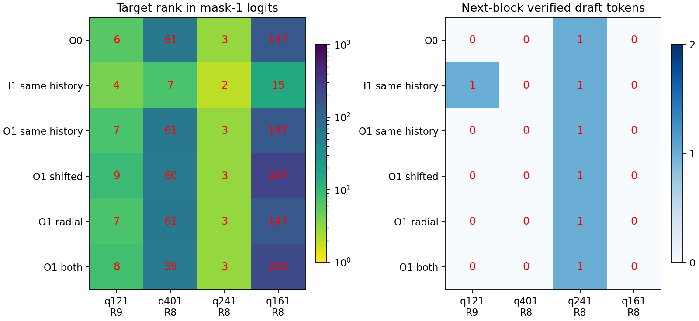
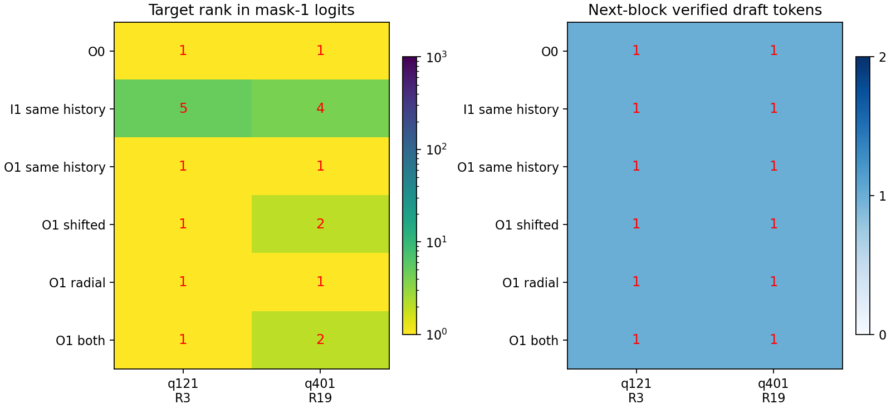

现状：固定数据下[五方法加AR](../../studies/qwen3_4b_bf16_five_methods/docs/STUDY_REPORT.md)完整11/11已验收；追加早期/双向/方向72格、192次forward，数学门全过。 
发现：原e2−e1对零偏置3胜1负；随机0也在q241提升，否定本批“只有原方向有效”，见[方向读出](4b-direction-controls-readout-2026-10-15.json) `comparisons`。 
发现：q121/q241双向替换接受数0↔1；其余保留反例，见[输出轨迹](4b-reciprocal-output-readout-2026-10-15.json)/[输入轨迹](4b-reciprocal-input-readout-2026-10-15.json)。 
下一步：本批结果PR合dev；第三方HF实现仅作非官方复现验收，不改变主实验或自行新增方法。 
阻塞：本批无资源阻塞、GPU已释放；已合远程分支[清理完成](remote-branch-cleanup-2026-10-15.md)，当前工作分支保留，第三方配置兼容性仍待验收。

# 4B 输出侧候选质量与固定窗口阶段报告

2026-10-15，接续[PR #17 的几何阶段](4b-mask-geometry-2026-10-15.md)。**当前证据指向下游候选质量、树结构及输入配方混杂：同一真实前缀下，输入一阶在4个无条件窗口给出更好的首目标排名，其中1个窗口实际多接受1个token；追加2个条件窗口却没有这种排名优势。输出一阶多数首槽没有直接速度路径，第二槽的改进还会受Top-1父节点扩展限制。** 这不是普遍因果份额或全量新τ结论，输入端还存在接近固定模板差分的具体混杂，EMA/初始化与表示选择仍未逐项分离。

## 一、问题、范围与证据

全480条旧结果已确认 BC30 输入一阶 τ=1.511958、输出零阶1.433178、输出一阶1.435540。此前几何显示输出对目标embedding的余弦并不更低，不能用向量相似度直接解释接受差距。本轮先分析原向量和全量seed深度转移，再执行固定前缀干预，不修改原科学源码、配方、成功Run或冻结PLAN。

| 证据 | 范围 | 文件 |
| --- | --- | --- |
| 原480条×三方法×两个BC | seed深度转移，原始SHA逐格核对 | [CPU结果](4b-mask-velocity-cpu-2026-10-15.json) `transitions`，各Run路径/SHA在同级字段 |
| 原12格保存向量 | 同owner两槽的径向/切向分解，零新增forward | 同CPU结果 `velocity`，`capture_sha256`、`vectors_sha256`绑定[前阶段观测](4b-mask-geometry-observations-2026-10-15.json)及本机 `.tmp/4b-geometry-capture-v5/vectors.pt` |
| 4个无条件固定窗口×6方法 | 24个局部对照，79次总forward | [原始标量](4b-mask-window-observations-2026-10-15.json) `rows`、`model_calls`、source/model/tool/plan SHA |
| 已保存GPU实际树与logits的CPU读出 | 同窗口比较、并列排名区间、候选覆盖反事实 | [窗口读出](4b-mask-window-readout-2026-10-15.json) `rows`、`comparisons` |

模型为原魔搭 Qwen3-4B BF16，T0/eager/default、双mask动态剪枝树、BC30/9节点，tied storage核验。输出EMA/范数沿用原生FP32内部状态，模型/forward/实际mask为BF16。没有FP32模型、新AR或teacher前向、8B、测速、算子数值追踪。原作者ESP来源缺口仍见[独立核查](esp-official-code-reproduction-2026-10-15.md)，本轮不替代官方代码复现。

工具：[CPU向量/转移分析](../../tools/analyze_4b_velocity.py)、[窗口工具](../../tools/diagnose_4b_mask_windows.py)、[树读出](../../tools/analyze_4b_window_results.py)。先提交[无条件窗口协议](../../studies/qwen3_4b_bf16_five_methods/docs/MASK_WINDOW_PLAN.md)，再执行采集。首批测量工具为 Git commit `ce7c329` 的原字节，SHA在原始标量 `tool_sha256`，后续条件入口不重新签收首批。

## 二、CPU排除与收紧

### 1. 归一化没有抹去大部分输出槽间移动

令 a=原始槽0，δ=原始槽1−槽0，分解 δ 的径向和切向分量。归一化移动保留比为 `‖(a+δ)/‖a+δ‖ − a/‖a‖‖ / (‖δ‖/‖a‖)`。它不是能量比，也不是接受率。每方法201对同owner槽，来自4个prompt，不能当201个独立prompt。输入端这里的分母a是已含速度的实际槽0，区别于前报告以mean作分母的3.33。

| 方法 | ‖δ‖/‖a‖ 均值（P05/P50/P95） | 切向范数/δ范数 | 归一化移动保留比 | 原始槽1/槽0范数比 |
| --- | --- | --- | --- | --- |
| 输入一阶 | 0.9227 (0.8552/0.9264/0.9732) | 0.2826 (0.2258/0.2699/0.3630) | 0.1495 (0.1152/0.1414/0.1997) | 1.9026 (1.8240/1.9076/1.9591) |
| 输出一阶 | 0.0946 (0.0689/0.0912/0.1313) | 0.9486 (0.8513/0.9639/0.9990) | 0.9263 (0.8164/0.9424/0.9988) | 1.0261 (0.9924/1.0260/1.0559) |

来源：CPU结果 `velocity[method].distribution`。**“归一化抹去大部分输出速度”这一具体解释未获支持：输出切向比例均值94.86%，归一化移动保留比均值92.63%。** 但输入端槽差更偏径向，原配方保留约1.90倍范数差，而输出统一固定半径；是否丢失有用的幅度仍需干预，不能仅凭范数比认定原因。

### 2. 输出一阶绝大多数首槽缺少直接速度通路

原 `output_masks.py` 深度0/1先用proxy替换anchor，再取槽0=anchor、槽1=anchor+v；深度2才先anchor+=v。因果注意力中首mask也不能读取第二mask。decoder使用最深接受owner的mask logits作为下一树seed。因此，上一块接受深度0/1时，固定相同历史/proxy的原生一阶不会直接改变首mask输入及其首目标logits；速度仍可经第二槽的树预算竞争、深度2反馈和后续路径间接作用。

| BC | 方法 | 实际块间转移数 | seed owner深度0/1/2次数 | 深度2占比 | 后一块d1接受率，按前块深度0/1/2分组 |
| --- | --- | --- | --- | --- | --- |
| 30 | 输入一阶 | 52,708 | 28,206/22,057/2,445 | 4.64% | 47.37%/47.07%/43.31% |
| 30 | 输出零阶 | 55,617 | 34,891/17,431/3,295 | 5.92% | 36.58%/38.78%/42.00% |
| 30 | 输出一阶 | 55,756 | 34,908/17,467/3,381 | 6.06% | 36.42%/39.51%/41.50% |
| 60 | 输入一阶 | 48,915 | 21,026/24,636/3,253 | 6.65% | 57.78%/57.89%/54.44% |
| 60 | 输出零阶 | 51,936 | 28,617/19,206/4,113 | 7.92% | 43.78%/46.08%/51.37% |
| 60 | 输出一阶 | 51,991 | 28,549/19,382/4,060 | 7.81% | 43.90%/46.39%/51.55% |

来源：CPU结果 `transitions[BC/method].counts`。统计只跨同prompt的真实相邻块，不含prefill到首块。BC30输出一阶有93.94%的seed来自深度0/1，BC60为92.19%。这是直接作用路径的限制，不等于这些块完全不受速度影响；分组接受率仍含路径/类别混杂，不能当因果效应。

### 3. 输入一阶接近固定模板偏置，不能直接归因于内容速度

480条prompt的前两个token对完全相同，因此原输入provider的首差分初始化方向相同。用已核验魔搭权重仅在CPU读取这两个embedding行，不加载模型或执行forward。对原4条prompt保存的138个验证块状态作核对，每块计一次，不按同块owner重复计数。

| 检查 | 均值 | 最大值 |
| --- | --- | --- |
| 当前速度相对模板初始差分的范数误差 | 0.0400% | 0.0949% |
| mean+固定初始差分 vs 实际槽0的相对误差 | 0.0436% | 0.0947% |
| mean+2×固定初始差分 vs 实际槽1的相对误差 | 0.0415% | 0.0951% |

速度与初始模板差分的余弦约1，范数比也约1。来源：CPU结果 `template_control` 的 `prompt_count=480`、`unique_first_two_pairs=1`、`distribution`（n=138）及embedding shard SHA。这里只读原生状态及做代数几何对照，没有换精度、追归约或解释舍入机制。

**这把H5从泛泛的EMA参数混杂收紧为具体替代解释：当前输入一阶在采样窗口近似“动态mean + 固定模板方向”，与输出端的内容相关hidden速度不是同一种控制。** 不能将它的全量优势直接归因于内容速度预测；也尚不能认定固定偏置是收益的唯一来源。实际向量接近不保证logits排名或接受轨迹相同；固定偏置替换的后续GPU验证见第八节。

## 三、固定同前缀的24个真实局部对照

固定q121/q401/q241/q161，分别取原输出零阶轨迹第一个root_index≥8的块，实际R=9/8/8/8。选择不依赖该窗口接受结果。同一前缀、当前cache和树、已验证hidden历史及proxy上，维护原生order1 shadow；输入一阶也按完全相同的真实token历史更新。输入控制不是原输入一阶全程Run的缓存轨迹。

| 干预 | 当前局部改变 |
| --- | --- |
| 输出零阶控制 | 原order0 mask |
| 输入一阶同历史 | 原mean+gamma、β=.9999/λ=.1/γ=1，按同一前缀更新 |
| 输出一阶同历史 | 原β=.9/β′=.99与原槽位/半径映射 |
| 首槽移位 | 将a+jv改为a+(j+1)v，逐槽仍固定半径 |
| 保留径向幅度 | 原槽公式，各槽统一以本owner原a范数作分母 |
| 两者同时 | 同时改上述两点 |

每格先在相同当前块上前向，再用最深接受owner的mask logits原生生成下一树并验证一个块。当前owner argmax全程保持不变，控制前缀与旧Run一致。mask嵌入位于owner+1/owner+2，其logits预测owner+2/owner+3；下表首目标是下一树root之后的第一个token，不能与前几何报告的mask输入目标错位比较。

| prompt/当前R | 干预 | 首/次目标原始logit排名 | 下一树d1/d2宽度 | 实际接受draft数 |
| --- | --- | --- | --- | --- |
| q121/R9 | 输出零阶控制 | 6/258 | 4/5 | 0 |
| q121/R9 | 输入一阶同历史 | 4/14 | 6/3 | 1 |
| q121/R9 | 输出一阶同历史 | 7/236 | 4/5 | 0 |
| q121/R9 | 输出一阶首槽移位 | 9/247 | 5/4 | 0 |
| q121/R9 | 输出一阶保留径向幅度 | 7/244 | 4/5 | 0 |
| q121/R9 | 移位+保留径向 | 8/250 | 5/4 | 0 |
| q401/R8 | 输出零阶控制 | 61/5 | 4/5 | 0 |
| q401/R8 | 输入一阶同历史 | 7/32 | 3/6 | 0 |
| q401/R8 | 输出一阶同历史 | 61/5 | 4/5 | 0 |
| q401/R8 | 输出一阶首槽移位 | 60/5 | 4/5 | 0 |
| q401/R8 | 输出一阶保留径向幅度 | 61/5 | 4/5 | 0 |
| q401/R8 | 移位+保留径向 | 59/5 | 4/5 | 0 |
| q241/R8 | 输出零阶控制 | 3/2 | 4/5 | 1 |
| q241/R8 | 输入一阶同历史 | 2/1 | 6/3 | 1 |
| q241/R8 | 输出一阶同历史 | 3/1 | 4/5 | 1 |
| q241/R8 | 输出一阶首槽移位 | 3/2 | 4/5 | 1 |
| q241/R8 | 输出一阶保留径向幅度 | 3/2 | 4/5 | 1 |
| q241/R8 | 移位+保留径向 | 3/3 | 4/5 | 1 |
| q161/R8 | 输出零阶控制 | 147/1 | 4/5 | 0 |
| q161/R8 | 输入一阶同历史 | 15/1 | 1/8 | 0 |
| q161/R8 | 输出一阶同历史 | 147/1 | 3/6 | 0 |
| q161/R8 | 输出一阶首槽移位 | 247/1 | 3/6 | 0 |
| q161/R8 | 输出一阶保留径向幅度 | 147/1 | 3/6 | 0 |
| q161/R8 | 移位+保留径向 | 200/1 | 3/6 | 0 |

来源：窗口读出 `rows[]` 同名字段。原始排名按严格大于目标logit的个数加1，可能存在并列；剪枝后的排名区间另见 `d1_pruned_rank_interval`，实际树以保存的GPU结构为准。

图源：同一窗口读出 `rows`；绘图函数为 `analyze_4b_window_results.py:plot_results`，PNG SHA在读出 `figure_sha256`。左图排名越低越好，右图是真实下一验证块接受的draft数。均为局部窗口，不是新全量τ。

### 局部结论与反例

1. **输入侧在同历史下确有候选质量优势反例。** 四个窗口的首目标原始排名分别从6/61/3/147改善到4/7/2/15。q121同时将d1宽度4改为6，实际接受0→1。说明差距不是仅由不同生成历史造成，也不是余弦较低必然导致候选较差。这里只证明四个局部窗口，不分配表示、EMA、初始化各自份额。
2. **原生输出一阶没有改善多数首目标分布。** q401/q241/q161的首mask logits与输出零阶逐元素一致，恰对应source owner深度0/0/1。q121深度2时分布改变，但目标排名6→7，没有产生收益。
3. **简单槽移位或保留径向幅度未救回本批窗口。** 相对输出零阶，四种输出干预均为0胜/4平/0负；输入一阶为1胜/3平/0负。来源：窗口读出 `comparisons`，按实际下一块接受数判定。它不是完整轨迹收益或总体显著性。
4. **排名、预算、父节点扩展必须分开。** q401输入控制的目标原始排名7、剪枝后6，在9节点总预算内，但第一深度只有3节点，仍不入树。q241原生一阶把第二目标排名2→1，实际仍只接受1个：正确d1虽然入树，却不是被扩展的Top-1父节点，因此该第二槽不能服务正确父路径。四个无条件窗口都没有正确d1为Top-1的下一树，这是本批检查第二步速度收益的实质限制。

## 四、零新增forward的结构覆盖反事实

CPU读出直接读取保存的GPU实际树。另计算两种**候选覆盖上界/可能性，不冒称实际接受**：将9节点全给第一深度；保持原d1/d2宽度但给已在树中的正确d1扩展第二层（oracle父节点，只是上界，部署时不知道真值）。按原始logits、重复剪枝与并列排名区间区分确定/可能覆盖。

| 干预 | 实际d1覆盖窗口数 | 全预算d1确定覆盖窗口数 | oracle正确父节点下d2确定覆盖窗口数 |
| --- | --- | --- | --- |
| 输出零阶控制 | 1/4 | 2/4 | 1/4 |
| 输入一阶同历史 | 2/4 | 3/4 | 1/4 |
| 输出一阶同历史 | 1/4 | 2/4 | 1/4 |
| 输出一阶首槽移位 | 1/4 | 2/4 | 1/4 |
| 输出一阶保留径向幅度 | 1/4 | 2/4 | 1/4 |
| 移位+保留径向 | 1/4 | 2/4 | 1/4 |

来源：窗口读出 `rows`。此表确定/可能覆盖计数恰好相同，完整区间仍保留。q241各方法在oracle正确父节点下可覆盖第二目标，却在真实Top-1展开中不能抵达；q401输入方法全给d1时可覆盖目标。这些只定位结构限制，没有执行对应反事实GPU验证或新轨迹，不宣称放宽树就提高τ。

初版CPU读出误将CPU重建树必须与保存GPU树结构相同设为硬门，遇到结构差异后停止输出。读出已改为以保存的GPU实际树为准，反事实用并列排名区间，不重复GPU、不研究跨设备排序/算子原因。

## 五、追加条件窗口与当前执行状态

为检验有真实第二深度机会时的输出速度作用，已另行冻结[条件协议](../../studies/qwen3_4b_bf16_five_methods/docs/MASK_ACTIVE_PLAN.md)：q121/q401各选原控制第一次下一块accepted_nodes=[1]的前驱，R=3/19，下一R=4/20。2窗口×6格，新增forward上限64。该样本按原控制结果条件选择，必须与上述4个无条件窗口分表，不能混算全量胜率。

**追加12/12格已完成，45次总forward，低于64预算。** 2/2零阶控制续接旧Run，12/12当前owner argmax不变、局部数学自检通过，36次局部选择检查；12/12下一验证短链仍与旧零阶轨迹一致。只有控制门和数学门作检查，没有新增独立AR前向。

来源：[条件采集](4b-mask-active-observations-2026-10-15.json) `rows`、`model_calls`、`sample_mode=conditioned_top1_only`，及[条件读出](4b-mask-active-readout-2026-10-15.json) `rows`、`comparisons`。条件选择明确以原控制的首步命中为依据，下面的结果不能估计无条件收益。

| prompt/干预R→下一R | 干预 | 首/次目标原始排名 | d1/d2宽度 | 实际接受draft数 |
| --- | --- | --- | --- | --- |
| q121/R3→R4 | 输出零阶控制 | 1/8152 | 3/6 | 1 |
| q121/R3→R4 | 输入一阶同历史 | 5/138 | 7/2 | 1 |
| q121/R3→R4 | 输出一阶同历史 | 1/12117 | 4/5 | 1 |
| q121/R3→R4 | 首槽移位 | 1/11995 | 2/7 | 1 |
| q121/R3→R4 | 保留径向幅度 | 1/10827 | 4/5 | 1 |
| q121/R3→R4 | 移位+保留径向 | 1/9567 | 2/7 | 1 |
| q401/R19→R20 | 输出零阶控制 | 1/40 | 4/5 | 1 |
| q401/R19→R20 | 输入一阶同历史 | 4/38 | 4/5 | 1 |
| q401/R19→R20 | 输出一阶同历史 | 1/36 | 5/4 | 1 |
| q401/R19→R20 | 首槽移位 | 2/28 | 6/3 | 1 |
| q401/R19→R20 | 保留径向幅度 | 1/38 | 4/5 | 1 |
| q401/R19→R20 | 移位+保留径向 | 2/29 | 5/4 | 1 |

所有非零阶干预相对控制均为0胜/2平/0负，来源为条件读出 `comparisons`。

图源：条件读出 `rows`，PNG SHA在 `figure_sha256`。这是按原控制结果选择的条件样本，不能与前图四个无条件窗口拼成六条随机样本。

**有第二步机会仍没有收益，不能只用“没机会”解释。** q121控制第二目标排名8152，原生一阶反而12117；q401由40改善到36，首槽移位到28，但第二层仅3–7节点，仍没有目标。局部候选质量距离远大于改动带来的排名改善。输入一阶在两处首目标排名从1变为5/4，反而更差，实际接受仍为1；这是输入方法并非每个局部上下文都更优的反例。

非抢占准入先后保留20次延期记录，均为0模型forward，第21次才完成采样，见[全部准入历史](4b-mask-active-admission-2026-10-15.json)。期间共享GPU被其他验证使用，未抢占、杀进程或并行加载本模型；自己的有上限等待队列在成功后退出，没有遗留等待任务。首批79+追加45=124次总forward，两个预算分别独立核验。所有权重、cache、完整logits和token留本机，新目录与旧Run都保留。

## 六、阶段判断与后续边界

- 已定位：输出侧落后主要在第一深度；同前缀局部输入mask能产生更好的下游候选；原生输出速度在多数seed首槽缺少直接通路，第二槽又受Top-1父节点与预算限制
- 已收紧：输入一阶在138个保存状态中近似固定模板差分，不能把当前优势归于内容速度预测；高目标余弦不保证更好mask；“范数映射错误”与“归一化抹去大部分输出移动”均未获当前证据支持；简单移位/保留径向幅度的无条件窗口没有收益
- 未证明：哪一个EMA参数、初始化或表示分布因素主导全480差距；不能用4个窗口或后续条件样本代替全量配对，不把相同cache的局部收益提升成新方法排名

条件窗口已经完成且没有输出接受增益。固定模板替换与同mean零速度对照已追加完成，见第八节；初始化/EMA完全匹配的两端对照仍未执行。不能从0.1%以内的mask误差推断接受完全一致。本轮不调默认配方、不跑完整矩阵，不进入算子数值链。

## 七、验证与交付

首批24/24当前owner argmax不变，24/24局部数学argmax检查通过，共73次局部选取检查；4/4零阶控制与旧Run续接一致，24/24下一验证短链与旧零阶轨迹一致。追加条件12格另有36次局部选择自检，全通过。73与36不含重建前缀的所有选择，不冒称完整新Run的全长token数。79次总forward含前缀重建与48次干预/下一块前向，低于128预算。独立AR未重跑，仍只作前阶段诊断。

回归覆盖径向/切向、跨prompt转移、固定state纯推演、原生BF16控制续接、未来目标与bonus索引、CPU准入及后代、条件选择拒绝、树预算/父节点/重复剪枝与并列区间。科学源码、旧成功Run与原冻结PLAN保持。正常提交、推工作分支、PR合dev沿Enmao长期授权，不合main、强推、删分支/数据。条件队列已退出，GPU进程已释放。PR/CI合并状态以GitHub实际结果为准。

## 八、追加：固定模板替换与零速度mean

### 设置与来源

按[独立冻结协议](../../studies/qwen3_4b_bf16_five_methods/docs/MASK_TEMPLATE_PLAN.md)，复用相同4个无条件窗口及2个条件窗口，每个只跑四格：原输出零阶、原生输入一阶、相同已更新mean加固定模板首差分、相同已更新mean加零速度。后两者只替换局部mask读出的速度，不改已提交真实历史；零速度mean等于updating mean，不是ESP frozen mean。未来验证块仍用相同输出零阶mask规则。

| 批次 | 原始观测 | CPU读出 | 总forward | 局部argmax选择检查 |
| --- | --- | --- | --- | --- |
| 无条件16格 | [标量及SHA](4b-mask-template-unconditional-observations-2026-10-15.json) | [读出](4b-mask-template-unconditional-readout-2026-10-15.json) | 63（上限96） | 51，全过 |
| 条件8格 | [标量及SHA](4b-mask-template-conditioned-observations-2026-10-15.json) | [读出](4b-mask-template-conditioned-readout-2026-10-15.json) | 37（上限48） | 24，全过 |

所有24格当前owner argmax不变、下一验证短链与旧零阶轨迹相同；6个零阶控制和6个原生输入控制的root、目标排名、树宽及实际接受数逐项复核前批结果一致。两批来源均为原魔搭模型/科学包，工具字节为Git `29b1d87`，source/model/tool/plan/private logits SHA在各原始观测。没有新增独立AR、8B、测速或全量Run。

### 实际读出与反证边界

表中输入列为“首/次目标排名；实际接受draft数”，输出零阶只列接受数；树宽、并列区间见读出 `rows`。无条件与条件样本保持分表。

| 无条件窗口 | 输出零阶接受数 | 原生输入一阶 | 固定模板速度 | 零速度mean |
| --- | --- | --- | --- | --- |
| q121/R9 | 0 | 4/14；1 | 4/14；1 | 7/9；1 |
| q401/R8 | 0 | 7/32；0 | 7/29；0 | 477/2；0 |
| q241/R8 | 1 | 2/1；1 | 2/1；1 | 3/1；1 |
| q161/R8 | 0 | 15/1；0 | 15/1；0 | 240/23；0 |

| 条件窗口 | 输出零阶接受数 | 原生输入一阶 | 固定模板速度 | 零速度mean |
| --- | --- | --- | --- | --- |
| q121/R3 | 1 | 5/138；1 | 5/147；1 | 2/37；1 |
| q401/R19 | 1 | 4/38；1 | 4/37；1 | 5/12；1 |

来源：两份读出 `rows`。相对原生输入速度，固定模板和零速度mean分别均为无条件0胜4平0负、条件0胜2平0负，见 `comparisons`。相对输出零阶，三种输入控制均为无条件1胜3平0负、条件0胜2平0负。

**固定模板能够替代这6处的原生速度接受行为，但没有证明固定偏置是局部增益的必要原因。** 固定模板与原生速度的第一目标排名、树宽和接受数在6处均相同，完整两行seed logits却6处均不相同（`seed_logits_equal_input_first=false`）；第二目标排名在3处不同。向量近似不能升级为完整logits或轨迹完全相同。

**同mean零速度也取得相同实际接受数，收紧了“速度造成q121增益”的解释。** q121/R9仅用updating mean就接受1个：第一目标原始排名7，重复剪枝后排名6，恰在d1宽6内；输出零阶剪枝后排名5却只有d1宽4。因此本例的0→1无需速度项，候选分布和预算分配即可达到。q401/R8的mean排名477被模板改善到7，但d1宽只有3，两者仍不接受；排名改善不能等同于接受收益。条件q121/R3中mean首目标排名2还优于原生输入5，仍是局部反例，不作全量排名结论。

### 下一假设的CPU定位

为避免继续扩充接受数不敏感的晚窗口，对旧BC30输入零阶/一阶480条结果进行只读定位，见[CPU结果](4b-mask-template-opportunities-2026-10-15.json)。算法是：按prompt配对；计算生成token的共同前缀；只比较两条实际trace共有且root仍在共同前缀内的位置；每条记录最早接受draft数不同的位置。所有来源Run路径、raw SHA、paired SHA及逐prompt位置在结果文件，不新增模型前向。

| 首个匹配root接受差异 | prompt数 |
| --- | --- |
| root=0（由prefill seed建首树） | 141 |
| root=1–7 | 318 |
| root≥8 | 21 |

来源：CPU结果 `counts`，共有23,281对匹配root；480条均找到接受差异。459/480的首次差异早于root8，说明现有root≥8窗口不足以覆盖最早起效区域；不代表459条都由初始化造成。首次差异时输入一阶较多246条、输入零阶较多234条，不能替代全轨迹赢平输或τ排名。

原4条prompt的首差异位置为q121/R2（0→1）、q401/R1（0→1）、q241/R3（0→1）、q161/R3（1→0），来源 `first_differences`，括号按输入零阶→输入一阶。**下一项更有区分力的实验应前移到prefill或这些早期差异块，并保留q161负对照；固定模板与零速度在该处是否仍持平尚未验证。** 两条原始路径的树、cache分块和provider历史可能不同，该CPU筛选按已有结果条件选择，仅用于找候选，不能直接分配因果份额。

### 准入、回归与执行状态

[全部19份准入/执行记录](4b-mask-template-admission-2026-10-15.json)保留了此前17份0-forward记录与最终两批成功记录。两次加载后停止是新未知Python进程触发保守门，没有模型forward；早期记录缺PID，不能把原因唯一归于同期CPU回归。后来核验多个外部CI查询、CPU校准准备脚本的字节，仅识别已读CPU工作，没有操作外部进程。自己的队列切换发生短暂重叠，目录保护拒绝重复调用，没有覆盖目录或执行模型；重复队列已结束。最终两批串行通过准入，100次forward全部来自成功批次，GPU和所有自己的等待队列已释放。所有延期、失败目录和完整logits均保留本机。

相关10项回归通过，包含纯速度替换保留同一已更新mean、零速度等价updating ESP、原生tiny BF16两组局部控制及argmax门。CPU读出扩展到template/input_first/input_mean配对后，旧24行和5组比较逐项不变。最终PR的完整CPU检查另按实际平台状态记录；不把本轮有限窗口持平外推为全480速度无用。

## 九、实际GPU准入与早期模板因果对照

### 准入修正

按Enmao最新指令，当前窗口工具不再枚举Windows Python、不读外部CPU脚本或登记SHA。只查询GPU0的nvidia-smi实际计算进程与显存：排除本PID，没有其他GPU驻留Python且初始free≥14GiB即放行；Windows桌面进程只通过实际free影响容量，不当作Python实验。14GiB覆盖4B BF16约8GB权重及临时KV/树余量，加载后不再次为自己的模型扣除初始容量。只用单个串行执行命令，没有后台或重叠等待队列。这是观测准入，仍不是全局原子锁。

前面各节保留旧准入历史，不能把那些CPU误延期解释为真实GPU忙。新回归仅允许调用nvidia-smi，覆盖桌面和本PID、外部GPU Python、低显存及空进程列表；CPU进程不再进入判定。旧几何工具/历史证据没有重签，本次只运行修正后的窗口工具。

### 固定早期16格

按[早期协议](../../studies/qwen3_4b_bf16_five_methods/docs/MASK_EARLY_TEMPLATE_PLAN.md)预先固定q121/R1→2、q401/R0→1、q241/R1→3、q161/R2→4。在原输出零阶的同一真实前缀/cache/tree上，只改变当前块的mask构造。q161的原输入两路径差异在R3，但输出零阶跳过R3，因此这里是邻近负对照，不声称精确复现R3。

新门一次放行，实际初始free=21,537MiB，所有准入记录的foreign_gpu_python_pids为空。16格全部完成，44次总forward（上限64），54次局部argmax选择检查全过，16格当前owner argmax及下一短链保持，4个零阶控制续接旧Run。没有AR新增前向、测速或8B。

来源：[原始标量及准入](4b-mask-template-early-observations-2026-10-15.json) `admission/model_calls/rows`、[CPU读出](4b-mask-template-early-readout-2026-10-15.json) `rows/comparisons`。测量工具为Git `3601c7f` 原字节，模型/source/协议/private logits SHA均绑定；完整logits留本机 `.tmp/4b-mask-template-early-v1/private_logits.pt`。

各格为“首/次目标排名；实际接受draft数”，不把排名直接当作接受。

| 当前→下一窗口 | 输出零阶 | 输入原生速度 | 输入固定模板 | 输入零速度mean |
| --- | --- | --- | --- | --- |
| q121/R1→R2 | 16/53；0 | 4/134；1 | 4/127；1 | 86/41；0 |
| q401/R0→R1 | 1/2；2 | 6/56；1 | 6/53；1 | 83/2159；0 |
| q241/R1→R3 | 4823/5；0 | 3/12；1 | 2/13；1 | 41/3；0 |
| q161/R2→R4 | 1/4；2 | 1/43；1 | 1/47；1 | 1/5；2 |

输入原生速度和固定模板各自相对零速度mean均为3胜0平1负，相对输出零阶均为2胜0平2负；固定模板对原生速度仍为0胜4平0负，见读出 `comparisons`。完整seed logits在4处均不同，q241首目标排名也从3变为2，不能宣称数值相同。

**这些早期窗口直接显示固定偏置的局部因果作用，且保留反例。** 在相同mean/真实历史/cache/tree上，仅添加固定模板速度，q121/q401/q241从0接受变1，q161反而从2变1。原生速度的这些接受行为可由固定方向复现，不需要其继续依赖内容更新；但mean仍依赖内容，也没有证明固定方向在全量轨迹必要或充分。

q161的零速度第二目标排名5、d2宽8，原生速度变43、d2宽7，实际从2降1；q401即使输入速度胜过零速度mean，仍低于输出零阶的2接受。这些正负结果不支持“输入一阶在每个早期上下文都胜过输出”。本轮没有干预prefill本体，R0 decode也不冒称prefill替换；双向构造互换另见下一节。

## 十、原输入与输出轨迹上的双向构造互换

按[双向协议](../../studies/qwen3_4b_bf16_five_methods/docs/MASK_RECIPROCAL_PLAN.md)，分别重建原输出零阶、原输入一阶的4个早期窗口。同一origin内，只换当前块mask构造为输出零阶、输入一阶或输出一阶；当前prefix/cache/tree/位置/注意力固定，下一验证块mask回到该origin原规则。输入origin只读观察原生final hidden，按真实已提交历史维护两种输出shadow，不改变原输入provider或生成历史。

| origin | 原始观测 | 读出 | forward | 局部argmax选择检查 |
| --- | --- | --- | --- | --- |
| 输出零阶 | [标量及SHA](4b-reciprocal-output-observations-2026-10-15.json) | [对照](4b-reciprocal-output-readout-2026-10-15.json) | 36 | 42，全过 |
| 输入一阶 | [标量及SHA](4b-reciprocal-input-observations-2026-10-15.json) | [对照](4b-reciprocal-input-readout-2026-10-15.json) | 36 | 30，全过 |

每批12格、上限64前向。所有24格当前owner argmax及下一短链保持；8个native控制的实际mask逐元素等于重建块mask，并续接各自旧Run。全部准入通过，无延期或重叠队列。工具为Git `f363dda`，来源/协议/model/private logits SHA在原始观测；完整logits留本机 `.tmp/4b-reciprocal-output-v1/`、`.tmp/4b-reciprocal-input-v1/`。

### 实际接受数

| 输出origin窗口 | 输出零阶（native） | 换输入一阶 | 换输出一阶 |
| --- | --- | --- | --- |
| q121/R1→R2 | 0 | 1 | 0 |
| q401/R0→R1 | 2 | 1 | 2 |
| q241/R1→R3 | 0 | 1 | 0 |
| q161/R2→R4 | 2 | 1 | 2 |

| 输入origin窗口 | 输入一阶（native） | 换输出零阶 | 换输出一阶 |
| --- | --- | --- | --- |
| q121/R1→R2 | 1 | 0 | 0 |
| q401/R0→R1 | 1 | 0 | 0 |
| q241/R1→R3 | 1 | 0 | 0 |
| q161/R2→R3 | 0 | 0 | 0 |

来源：两份读出 `rows[].next_accept_depth`。输出origin输入替换相对native为2胜0平2负；输入origin两种输出替换相对native均0胜1平3负。后者见读出 `zero-input_first/first-input_first`，不误用默认zero比较列。输出一阶对零阶在两个origin均为0胜4平0负。

**q121/q241出现了局部可逆翻转：输出轨迹0→1，输入轨迹换回输出后1→0。** 在同一origin固定状态内，mask构造选择足以改变下一树及真实接受，支持局部因果作用。q401却在原输出轨迹以输出构造最好、原输入轨迹以输入构造最好；q161反向未恢复命中，不能推广成普遍可逆。

四对当前root以前的实际token前缀逐项相同，见[已执行窗口前缀核验](4b-reciprocal-prefix-audit-2026-10-15.json)；这是执行后核验，不是新一轮CPU筛选。两origin的当前树、代理hidden和历史缓存分块仍可能不同，不能把跨origin差值当作只换表示的同状态实验。q161的下一root分别4/3尤其不能拼成同一个位置。没有进入算子数值排查。

## 十一、Enmao指定的四类方向对照

按[方向协议](../../studies/qwen3_4b_bf16_five_methods/docs/MASK_DIRECTION_PLAN.md)，只在相同4处输出origin早期窗口追加分析格。数据SHA和原480条manifest不变，模型实际input_ids始终取原manifest。对照不是新主方法，不进入五方法排名或改写其完整Run。

四类为原固定e2−e1、同范数随机方向（固定种子0/1/2，不选最优）、零偏置updating mean、内容初始化速度；另保留原生输入速度与输出零阶控制。所有输入格的完整prompt mean和后续λ更新相同。正文起始从原SpecBench第一turn及原tokenizer offset核验，四处均index3；仅把速度初始化移到正文首差分，继续原prompt后缀和committed历史EMA，不重写prompt或模板。

**32格完成，76次总forward（上限96），99次局部argmax选择检查全过。** 全部当前owner argmax、下一短链及零阶旧Run控制通过；原模板/native/零偏置的已测控制保持。来源：[方向原始观测](4b-direction-controls-observations-2026-10-15.json) `admission/model_calls/data_sha256/prompts_manifest_sha256/content_start_indices/rows`、[方向读出](4b-direction-controls-readout-2026-10-15.json) `rows/comparisons`。测量工具Git `de58a84`，完整logits留本机 `.tmp/4b-direction-controls-v1/`。

### 接受数与配对比较

| 窗口 | 原生输入v | 固定e2−e1 | 随机0 | 随机1 | 随机2 | 零偏置 | 内容初始化 |
| --- | --- | --- | --- | --- | --- | --- | --- |
| q121/R1→R2 | 1 | 1 | 0 | 0 | 0 | 0 | 0 |
| q401/R0→R1 | 1 | 1 | 0 | 0 | 0 | 0 | 0 |
| q241/R1→R3 | 1 | 1 | 1 | 0 | 0 | 0 | 0 |
| q161/R2→R4 | 1 | 1 | 1 | 1 | 1 | 2 | 1 |

来源：方向读出 `rows[].next_accept_depth`。以下按该列计胜平负，随机种子分别保留。

| 分析格 | 相对零偏置胜/平/负 | 相对固定e2−e1胜/平/负 |
| --- | --- | --- |
| 原生输入v | 3/0/1 | 0/4/0 |
| 固定e2−e1 | 3/0/1 | 自比较不适用 |
| 随机0 | 1/2/1 | 0/2/2 |
| 随机1 | 0/3/1 | 0/1/3 |
| 随机2 | 0/3/1 | 0/1/3 |
| 内容初始化 | 0/3/1 | 0/1/3 |

来源：方向读出 `comparisons[variant-input_mean/variant-input_template]`。固定模板与原生输入v仍在这4处接受数相同，不能声称完整logits相同。

### 范数与方向核验

| 随机种子 | 实际速度范数/原e2−e1范数 | 与原方向余弦 |
| --- | --- | --- |
| 0 | 0.9999635 | 0.0305450 |
| 1 | 1.0000664 | 0.0146537 |
| 2 | 1.0000499 | −0.0469948 |

来源：原始观测 `rows[].direction_state`，同种子在4处使用同一方向；最大范数误差约0.00664%，通过预设<1%门。方向由独立CPU Generator采样并缩放，实际model/mask为BF16，未运行FP32模型。内容初始化范数比为1.3687–1.4582，没有范数匹配，因而其方向与幅度效应不能分开；报告未新增未授权的归一化内容方法。

**本批否定“只有e2−e1方向才能产生提升”的强版本：随机0在q241也从0接受变1。** 但原方向在q121/q401/q241三处都提升，三个随机方向只在其中一处命中，内容初始化本批未提升；原方向在这4个条件选择窗口更稳定。3个随机种子不是方向空间穷举，4处不是独立随机prompt样本；不能证明全量提升唯一来自模板方向，也不能把内容控制的负结果外推为内容信息无价值。

## 十二、主实验范围与集成

完整五方法加AR仍以原[Study报告](../../studies/qwen3_4b_bf16_five_methods/docs/STUDY_REPORT.md)、[正式配对证据](../../studies/qwen3_4b_bf16_five_methods/docs/paired_evidence_v1.json)及[原生process核验](../../studies/qwen3_4b_bf16_five_methods/docs/native-process-evidence-v1.json)为准：11/11完成，五方法在BC30/60各480条、独立AR一次480条；10个Spec Run共809,118个提交token的argmax自检通过。新增方向/构造控制只作分析，不改主数据和prompt，不重跑或重新命名主方法，不宣称新全量τ。

本轮早期模板16格、双向24格、方向32格合计192次forward及225次局部选择检查，窗口和控制有重复，不能当72个独立样本。prefill本体、不同数据或模板未改动或测试；新idea等待Enmao，不自动开启新Study。14项窗口/文档回归与全仓Ruff通过，GPU已释放，自己的等待队列为零。

[远程分支清理清单](remote-branch-cleanup-2026-10-15.md)记录已删除合dev的`feature/output-space-prerequisite`，当前`feature/sd-stage-report`因仍在使用而保留。正常按主题commit/push/PR合dev，不合main、不强推、不删实验数据。第三方HF ESP已核验到dataset仓库commit `ad76f8da29f3bfc7faa20488193c6aa83a9f708c`，属非作者官方，后续单独记录配置兼容和数学门验收，不把第三方已有数字当本机Table1复现。
