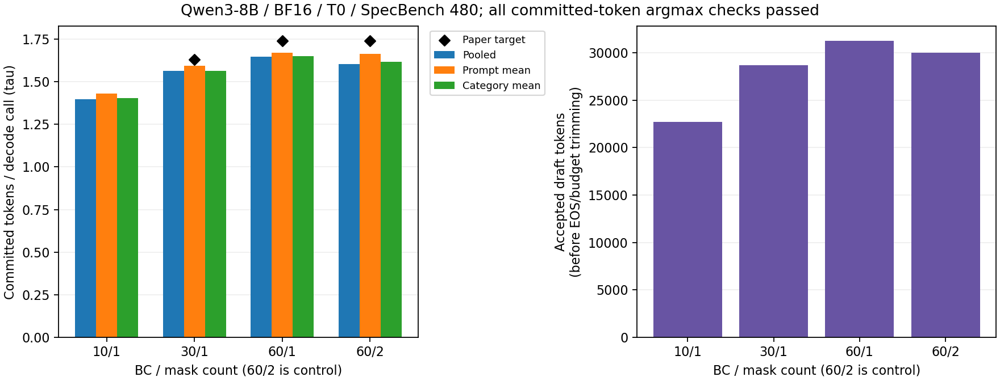

# ESP Table 1 Qwen3 BF16 protocol report

480 prompts; completed=4/4; 全四格验收=passed. 已完成格的τ/argmax有效性单列，AR失配不否定该格。BC60/1 is primary and BC60/2 is control, fixed before results.

| BC/masks | role | τ/argmax结果 | native状态 | AR exact/n (rate) | argmax checked/pass | pooled τ | τ − target | prompt mean τ | mean − target | category mean τ | category − target |
| --- | --- | --- | --- | --- | --- | --- | --- | --- | --- | --- | --- |
| 10/1 | primary | valid | succeeded | 188/480 (39.17%) | 79757/True | 1.399047 | n/a | 1.431766 | n/a | 1.403034 | n/a |
| 30/1 | primary | valid | succeeded | 175/480 (36.46%) | 79762/True | 1.563378 | -0.066622 | 1.593232 | -0.036768 | 1.563387 | -0.066613 |
| 60/1 | primary | valid | succeeded | 185/480 (38.54%) | 79618/True | 1.647301 | -0.092699 | 1.669498 | -0.070502 | 1.649693 | -0.090307 |
| 60/2 | control | valid | succeeded | 187/480 (38.96%) | 79693/True | 1.603729 | -0.136271 | 1.664315 | -0.075685 | 1.616079 | -0.123921 |

目标BC30=1.63，BC60双方均列相对1.74差值，不按τ选主配置。AR独立审计失配单列，不能宣称与独立AR一致；不阻止τ计算。τ验收要求全480、全部提交token的验证前向argmax自检通过，不以预检替代结果。

聚合定义：pooled τ=Σcommitted/Σdecode_calls；prompt mean τ为逐条committed/max(decode_calls,1)的等权均值；category mean τ先按原始category各算pooled τ，再对类别等权。类别样本数不等，不能把该权重称为论文已确认的任务权重；分组见[prompt清单](prompts_manifest.json)。

计数定义：committed为解码阶段实际提交数，包含bonus，经过EOS/预算裁剪，不含prefill首token。argmax审计覆盖完整新输出（含prefill首token），因此全480条的argmax checked比Σcommitted多480；实际model calls=Σdecode_calls+480。accepted为候选接受数，不能替代committed或τ。

[PLAN](<../../../docs/研究计划 Denoising Speculative Decoding.md#legacy-studies-esp-table1-bf16-full-argmax-docs-plan>)引用G.2具体说明：Qwen3 BC60单mask/29节点，双mask/19节点为对照；保持动态树剪枝，BF16/T0/256/seed123，无测速/预热。

Mean mask按Eq5 λ=.1更新，与后续4B用户指定的ESP frozen mean不同。四格全部新Run，旧冻结PLAN不回写；旧AR门失败result归档；仅重新验收后记录真实native状态及新validator SHA，不重跑execute。新增argmax必须全过；独立AR差异不阻塞native summarize/process。

逐prompt计数、AR首分叉位置和自检覆盖及哈希见[protocol_evidence_v1.json](protocol_evidence_v1.json)。完整原始tokens/argmax选择记录/Run仅在本机保留，未运行格不能用预检外推。

结论：主配置pooled τ按两位小数与论文目标不一致。数学自检与原生生命周期通过不等于论文τ数值复现成功；三种聚合和双mask对照全部保留，不事后择优。

[原生process验收证据](native-process-revalidation-v1.json)记录四格成功状态及旧process归档哈希。

图：同一四格480条，三种τ聚合及真实accepted draft总数（EOS/预算裁剪前）；黑菱形为论文目标。来源[protocol_evidence_v1.json](protocol_evidence_v1.json)，AR一致率另列，不含测速。

[原生Experiment/Run数字表](NUMBERS.md)保留单Run的mean/std/min/max/n及原生指标，绑定已验收process与formatter SHA；日志仅本机保留，公开副本去掉其超链接。未重新执行或改动本轮数值与结论。
