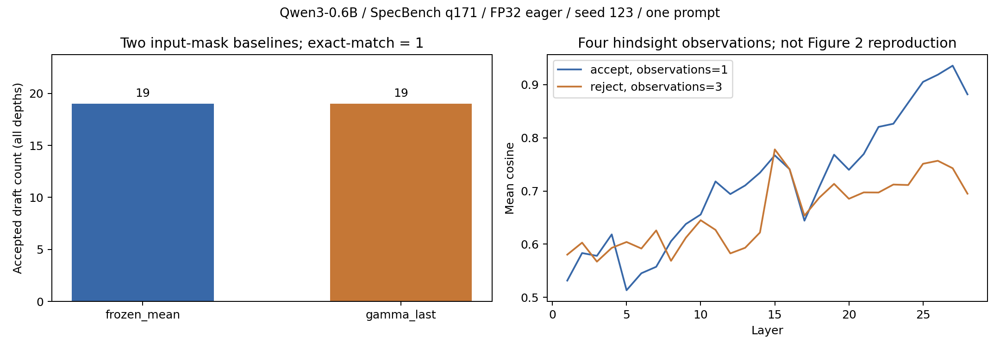

# Study Report: input_mask_baseline

当前v4四格执行完成，真实输入空间前置质量门通过；v3的完整性误拒绝与证据保留。问题、条件和停止门见 [PLAN](PLAN.md)。四个真实模型 case 的结果不能由 Toy/Stub 或随机 tiny 代替；没有执行的数字留空。

## v2历史前置状态（2026-10-14）

执行来源升级为固定 RPipe v0.3.1 / 7a15c46；采用 input-mask-baseline-v031-win5090-20261014-v2。实际 make 展开四格成功，配置保留模型/输入/精度/seed/预算和离线门；[设备前检](v031_device_preflight.json) 保存四 Run ID 与来源。make 的通用模型估算为每 Run 26.5GiB/3秒，round1 独占；这是启发式估计，不是0.6B实际资源或 wall 测量，不能用于资源/速度结论。

Study/default ModelScope local_files_only 核验均返回 CacheNotFound E1022；没有已确认 Qwen3-0.6B snapshot。当前仅有资源 inventory，未进行真实模型串行校准，也未 launch 四 Run。执行完成=false，研究质量通过=false；frozen_mean、gamma_last、AR、alignment 均无新数字、图或 raw token。未使用其他规模模型替代，也未下载/替换 snapshot、放宽 exact_match=1 或扩大矩阵。等待缓存路径后继续来源核对与原 PLAN。

| case | Run ID | 状态 |
| --- | --- | --- |
| frozen_mean | 2e1ef22e0f4ae1de | 未执行，缺权重 |
| gamma_last | 718122580b383b67 | 未执行，缺权重 |
| AR | 40bd71c3d907ba5a | 未执行，缺权重 |
| alignment | 1bbbabc47cdc703c | 未执行，缺权重 |

本轮n=1工程前置门不支持宏观H1–H13或方法优越性。源码升级的工程门在 smoke 报告单列，不替代本表。

## v3 ModelScope新来源运行（2026-10-14）

按用户明确要求下载Qwen3-0.6B到本Study，Run保持离线；snapshot文件来源见 [ModelScope清单](modelscope_snapshot.json)，ModelScope提示不能确认可变master revision，故不声称远端commit固定，实际模型digest/文件哈希绑定。加载FP32/eager/cuda:0与 [加载校准](resource_load_calibration.json) 已通过。选中question_id171、translation第11条，未重复历史前10条正式数据格子。

四Run均succeeded、来源/证据成功门通过，两ESP各exact-match=1并与独立AR均生成47 token；frozen_mean与gamma_last的all-depth accepted均19（各depth1也19），committed均46（另有prefill首token），decode_calls分别27/28，τ分别1.7037037/1.6428571。AR写47-token输出，无ESP接受/τ指标；alignment四个hindsight观察中accepted1/rejected3，28层CSV由原sums/counts核验，不是Figure2完整复现。n=1只构成前置门，无机制或泛化结论。

[保留v3正式精选原始证据](v3_execution.json)。launch及单独process均exit1：expected_factors_match=false，其余Run/seed/source/evidence均通过。B-008为下游把合并有效algorithm.config与原始轴补丁相比较的误拒绝，通用process.complete=false；没有生成v3 NUMBERS或把旧结果重签。源码修复后必须新v4身份纠错验收，当前不能把四Run成功写成Study质量通过。原Run/日志/index/process在本机原目录与.tmp/input-mask-ms-20261014/v3-preserved保留，非Git raw制品不随clone提供。

## v4正式前置验收（2026-10-14）

[正式原始精选JSON](v4_execution.json)、[数字表](NUMBERS.md)。同一ModelScope下载snapshot、q171单prompt、float32/eager/CUDA、T0、seed123、100-token预算与EOS停止；B-008只修正确因素期望，decoder/Data/Model和全部科学配方未改。四Run均succeeded，Study complete=true、passed=true、有效因素/seed/source/evidence门通过；当前源码digest ff2212ccbccb0e4e。

| case | Run ID | generated | accepted（所有深度） | decode calls | τ | exact-match | est秒 | 实际Flow秒 |
| --- | --- | ---: | ---: | ---: | ---: | --- | ---: | ---: |
| frozen_mean | b8a0278d5d9affaa | 47 | 19 | 27 | 1.7037037 | 1 | 3 | 20.389 |
| gamma_last | 66b19d103fe58810 | 47 | 19 | 28 | 1.6428571 | 1 | 3 | 19.952 |
| AR | f63a6a08958abfce | 47 | — | — | — | 不适用 | 3 | 17.687 |
| alignment | feca016a2c4774c1 | 不生成正式输出 | 不适用 | — | — | 不适用 | 3 | 19.893 |

两ESP与独立AR完整output token完全相同，共47个新token。committed=46不含prefill首token；accepted使用原所有深度/末步截断前口径，EOS截断时不可简单套accepted+decode_calls。depth1 accepted均19，depth2/3为0；frozen_mean尝试27，gamma_last尝试28。alignment有四个hindsight观察（accepted1/rejected3）和28层原sums/counts；不填造ESP指标。

v3→v4输入、output/AR token、接受/调用/KV轨迹、AR计数、alignment sums/counts全部逐项相同，耗时不参与相等判断。对照脚本初次误把AR ar_time也比较，检查确认仅该计时字段不同后按既定语义范围修正，未改Run或质量门。v3成功Run不重新签来源，v4使用新身份与真实执行；v3失败终验保留。

[打开真实结果图](figures/input_mask_baseline_v4.png)

图源为v4_execution.json，n=1 prompt/seed123。左图是两ESP的all-depth接受计数，右图按层显示一次accepted与三次rejected观察的mean cosine；相关hindsight观察不当作独立样本，不宣称复现Figure2或方法优越性。复跑图：`python studies/input_mask_baseline/plot_results.py`，不执行Run。

### 资源与执行条件

加载校准（不生成token）：596049920参数、FP32/eager，CUDA allocator峰值2384724992 bytes，RSS采样峰值5139087360 bytes。v4为原生round1单GPU串行，整轮make启发式估计12秒，launch含初始化、源/模型hash与Study终验实测96.989秒；每Run的Flow墙钟见表，两者计时边界不同。通用make的26.5GiB/Run并非实测，不据此扩大并发或调参。

v4进程树采样RSS峰值6612164608 bytes，线程峰值51（包含加载/服务线程）；OMP/MKL算子线程设1。nvidia-smi设备memory.used采样峰5464MiB，含背景图形占用且0.5秒采样可能漏短峰，不等于精确allocator峰。系统主存可用量采样最低17217077248 bytes；各进程I/O计数与采样边界在正式JSON及本机.tmp日志保存，计数不等于物理磁盘流量。没有其他本任务实验与四格竞争，没有速度排名。

正式Run实际runtime：torch2.11.0+cu130 / CUDA13 / Transformers5.12.1，matmul TF32=false、cuDNN TF32=true、matmul_precision=highest、deterministic=false、cudnn_benchmark=true、eager、FP32；加载校准只测加载，原默认benchmark=false不覆盖正式Run。原权重/tokenizer/config与实际模型digest均绑定到同一snapshot，ModelScope对master的确认警告保留，不声称远端revision不可变。

### 结论与边界

执行完成=true；本次真实输入空间前置质量通过=true。n=1未提供稳定性、泛化、EMA机制优势或H1–H13支持。未运行输出空间/Kalman、完整Figure2/论文矩阵、长模型矩阵、并发或解码恢复；这些不冒充本次通过。Run/raw/log/权重在本机Study runs/shared与.tmp/input-mask-ms-20261014，不随clone；正式JSON/图/PLAN/报告和只读图工具入库。NUMBERS保留原数值，将raw log引用改为明确本机文本，避免clone中的失效链接。
