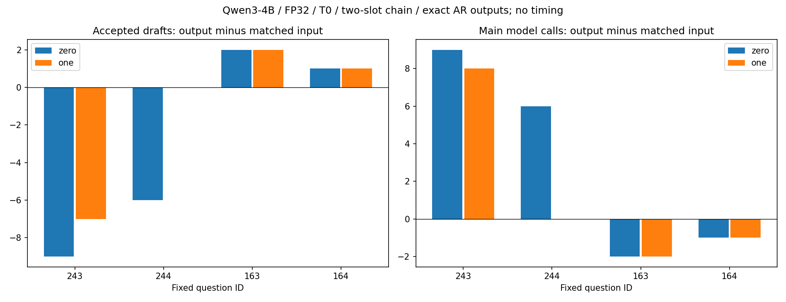

# Qwen3-4B 输出空间配对复验报告 — FP32 archive

精度标注：本 Study 已有模型实验全部使用 FP32，不能作为 BF16 证据。2026-10-15 起归档；新实验按 ESP Table 1 → Qwen3-4B BF16 五方法配对顺序执行。冻结的 PLAN、配置与执行证据保持原字节。

2026-10-15，4条固定prompt；全部原生Run及Study质量门通过。

## 结论

输出零阶相对输入冻结均值：接受数净差-12，主生成模型调用数净差+12；逐prompt接受增／平／减为2/0/2。

输出一阶相对输入冻结均值：接受数净差-4，主生成模型调用数净差+5；逐prompt接受增／平／减为2/1/1。

输出一阶相对输出零阶：接受数净差+8，主生成模型调用数净差-7；逐prompt接受增／平／减为2/2/0。

本批结果未同时支持“输出零阶与一阶都比输入基线有总接受收益”。这是当前同树／同prompt／同模型条件的事实，不代表各prompt均改善、速度提高或统计泛化。

## 协议与历史证据

[冻结PLAN](PLAN.md)与[输入清单](prompts_manifest.json)：Qwen3-4B，FP32/eager/CUDA，T0，EOS/max100，非thinking，seed123+prompt序号；三方法同unpruned静态[1,1]、k2/BC9。输入基线是本研究ESP冻结输入均值；输出beta=.9、beta_prime=.99、缩放映射保持原科学实现。实际输入/输出共享权重由两output decoder的storage门核实；四Run实际model_digest相同。

[历史检索](history_inventory.json)找到的4B数字是输入空间方法：first26单槽680/704/777，[7,2]双槽621/704，全480冻结均值12809与选定EMA15009；旧Run原始制品未保留，未找到能核验的旧output0/output1结果与配置。因此不宣称精确复现旧输出收益，亦不直接拿不同树的旧接受数与本次配对比较。旧输入EMA选定参数也不当作输出一阶参数。

[模型快照](modelscope_snapshot.json)记录本机14文件SHA，文件名/大小与官方ModelScope列表一致，离线权重经Study shared junction复用。预存目录的原始下载来源及不可变remote revision未确认，不把名/大小相同当字节一致；实际模型摘要见[原生证据](execution_v1.json)。没有新下载或权重量化/卸载，直接CUDA载入同FP32模型仅避免完整host副本。

eval.warmup=false；Study局部适配在execute期间替换decoder模块时钟为恒定0，不读取解码clock，全局时间模块不变。原生兼容timing/throughput/speedup字段若为0均为禁用占位，不能解释为零延迟或性能数据。这里仅比较调用计数，不测速。

## 配对数字

| 方法 | 接受draft | 主生成模型调用 | accept_d1 | accept_d2 | 生成新token |
| --- | ---: | ---: | ---: | ---: | ---: |
| 输入冻结均值 | 51 | 189 | 42 | 9 | 240 |
| 输出零阶 | 39 | 201 | 35 | 4 | 240 |
| 输出一阶 | 47 | 194 | 40 | 7 | 240 |
| 独立AR | 不适用 | 240 | 不适用 | 不适用 | 240 |

主生成调用：spec=prefill_calls+decode_calls，AR=ar_calls；每个spec额外独立AR审计计入实验总预算，排除在主路径配对调用数之外。accepted沿用预算/EOS最终裁剪前draft验证计数，不能将accepted差自动等同实际省下的调用差。所有三种输出逐token等于自身AR及第四独立AR Run；没有为了匹配而裁剪或改变输入。

| qid | 类别 | 输入 接受/调用 | 零阶 接受/调用 | 一阶 接受/调用 | AR调用 |
| --- | --- | ---: | ---: | ---: | ---: |
| 243 | summarization | 22/78 | 13/87 | 15/86 | 100 |
| 244 | summarization | 23/77 | 17/83 | 23/77 | 100 |
| 163 | translation | 4/27 | 6/25 | 6/25 | 31 |
| 164 | translation | 2/7 | 3/6 | 3/6 | 9 |

配对接受差分统计（sample stdev，固定非随机prompt集合，不作显著性判决）：

| 配对 | n | mean | stdev | min | max |
| --- | ---: | ---: | ---: | ---: | ---: |
| 输出零阶−输入冻结均值 | 4 | -3.0000 | 5.3541 | -9 | 2 |
| 输出一阶−输入冻结均值 | 4 | -1.0000 | 4.0825 | -7 | 2 |
| 输出一阶−输出零阶 | 4 | 2.0000 | 2.8284 | 0 | 6 |

图依据execution_v1.json逐prompt生成，左图接受差、右图主路径调用差；横向正负均保留，右图负值只代表更少调用，不是实测加速。

## 验收、失败保全与边界

四Run全部succeeded、source/model/input/完整性/AR硬门通过；科学source仍670c744e0535dcad，package/default未改。实际生成新token（含三份内部AR审计）1680，实际生成forward总数1544，零teacher、零warmup。完整Runs/cache/weights在本机，formal证据随本地提交，不推送/PR/合并。

这些4条是first26之外固定summarization/translation skip2/take2，按主批次启动前协议选择，不因主批次收益替换。与[主first26报告](../../output_space_4b_recheck_v2/docs/STUDY_REPORT.md)分层，不当额外独立seed或总体显著性证据。下一步应在4B扩大固定任务范围或配方对照；当前不恢复0.6B罕见位置分析。

未验证：未定位旧output-space4B正结果的完整配方，历史最优输入EMA的同链配对，多seed采样／多设备／更长预算／速度与全量任务泛化。不能从调用减少直接推断加速。

## 后续历史输入EMA控制已执行

[控制报告](../../output_space_4b_input_control/docs/STUDY_REPORT.md)显示相同新4条的EMA39接受/202调用；零阶39/201、一阶47/194。零阶相对EMA净0，一阶+8，但冻结均值51/189仍领先；不能把改变比较对象后的改善当作原冻结均值负结果被推翻。输出/独立AR成功Run未重复，当前主模型4B，0.6B rare/单位置不继续。
