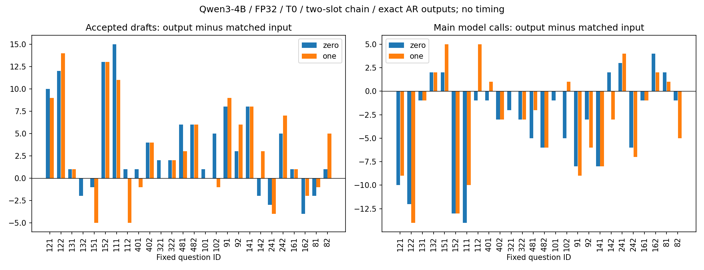

# Qwen3-4B 输出空间配对复验报告 — FP32 archive

精度标注：本 Study 已有模型实验全部使用 FP32，不能作为 BF16 证据。2026-10-15 起归档；新实验按 ESP Table 1 → Qwen3-4B BF16 五方法配对顺序执行。冻结的 PLAN、配置与执行证据保持原字节。

2026-10-15，26条固定prompt；全部原生Run及Study质量门通过。

## 结论

输出零阶相对输入冻结均值：接受数净差+91，主生成模型调用数净差-89；逐prompt接受增／平／减为20/0/6。

输出一阶相对输入冻结均值：接受数净差+83，主生成模型调用数净差-79；逐prompt接受增／平／减为16/3/7。

输出一阶相对输出零阶：接受数净差-8，主生成模型调用数净差+10；逐prompt接受增／平／减为9/7/10。

在本批固定输入上，零阶与一阶相对输入基线均有总接受收益。这是当前同树／同prompt／同模型条件的事实，不代表各prompt均改善、速度提高或统计泛化。

## 协议与历史证据

[冻结PLAN](PLAN.md)与[输入清单](prompts_manifest.json)：Qwen3-4B，FP32/eager/CUDA，T0，EOS/max100，非thinking，seed123+prompt序号；三方法同unpruned静态[1,1]、k2/BC9。输入基线是本研究ESP冻结输入均值；输出beta=.9、beta_prime=.99、缩放映射保持原科学实现。实际输入/输出共享权重由两output decoder的storage门核实；四Run实际model_digest相同。

[历史检索](history_inventory.json)找到的4B数字是输入空间方法：first26单槽680/704/777，[7,2]双槽621/704，全480冻结均值12809与选定EMA15009；旧Run原始制品未保留，未找到能核验的旧output0/output1结果与配置。因此不宣称精确复现旧输出收益，亦不直接拿不同树的旧接受数与本次配对比较。旧输入EMA选定参数也不当作输出一阶参数。

[模型快照](modelscope_snapshot.json)记录本机14文件SHA，文件名/大小与官方ModelScope列表一致，离线权重经Study shared junction复用。预存目录的原始下载来源及不可变remote revision未确认，不把名/大小相同当字节一致；实际模型摘要见[原生证据](execution_v1.json)。没有新下载或权重量化/卸载，直接CUDA载入同FP32模型仅避免完整host副本。

eval.warmup=false；Study局部适配在execute期间替换decoder模块时钟为恒定0，不读取解码clock，全局时间模块不变。原生兼容timing/throughput/speedup字段若为0均为禁用占位，不能解释为零延迟或性能数据。这里仅比较调用计数，不测速。

## 配对数字

| 方法 | 接受draft | 主生成模型调用 | accept_d1 | accept_d2 | 生成新token |
| --- | ---: | ---: | ---: | ---: | ---: |
| 输入冻结均值 | 238 | 1955 | 210 | 28 | 2191 |
| 输出零阶 | 329 | 1866 | 308 | 21 | 2191 |
| 输出一阶 | 321 | 1876 | 299 | 22 | 2191 |
| 独立AR | 不适用 | 2191 | 不适用 | 不适用 | 2191 |

主生成调用：spec=prefill_calls+decode_calls，AR=ar_calls；每个spec额外独立AR审计计入实验总预算，排除在主路径配对调用数之外。accepted沿用预算/EOS最终裁剪前draft验证计数，不能将accepted差自动等同实际省下的调用差。所有三种输出逐token等于自身AR及第四独立AR Run；没有为了匹配而裁剪或改变输入。

| qid | 类别 | 输入 接受/调用 | 零阶 接受/调用 | 一阶 接受/调用 | AR调用 |
| --- | --- | ---: | ---: | ---: | ---: |
| 121 | coding | 5/95 | 15/85 | 14/86 | 100 |
| 122 | coding | 6/94 | 18/82 | 20/80 | 100 |
| 131 | extraction | 3/11 | 4/10 | 4/10 | 14 |
| 132 | extraction | 6/10 | 4/12 | 6/12 | 16 |
| 151 | humanities | 13/87 | 12/89 | 8/92 | 100 |
| 152 | humanities | 3/97 | 16/84 | 16/84 | 100 |
| 111 | math | 13/87 | 28/73 | 24/77 | 100 |
| 112 | math | 10/64 | 11/63 | 5/69 | 74 |
| 401 | math_reasoning | 20/80 | 21/79 | 19/81 | 100 |
| 402 | math_reasoning | 16/84 | 20/81 | 20/81 | 100 |
| 321 | qa | 2/71 | 4/69 | 2/71 | 73 |
| 322 | qa | 10/75 | 12/72 | 12/72 | 84 |
| 481 | rag | 13/87 | 19/82 | 16/85 | 100 |
| 482 | rag | 9/91 | 15/85 | 15/85 | 100 |
| 101 | reasoning | 15/85 | 16/84 | 15/85 | 100 |
| 102 | reasoning | 8/92 | 13/87 | 7/93 | 100 |
| 91 | roleplay | 3/97 | 11/89 | 12/88 | 100 |
| 92 | roleplay | 5/95 | 8/92 | 11/89 | 100 |
| 141 | stem | 5/95 | 13/87 | 13/87 | 100 |
| 142 | stem | 12/88 | 10/90 | 15/85 | 100 |
| 241 | summarization | 18/82 | 15/85 | 14/86 | 100 |
| 242 | summarization | 14/87 | 19/81 | 21/80 | 100 |
| 161 | translation | 4/13 | 5/12 | 5/12 | 17 |
| 162 | translation | 8/21 | 4/25 | 6/23 | 29 |
| 81 | writing | 7/93 | 5/95 | 6/94 | 100 |
| 82 | writing | 10/74 | 11/73 | 15/69 | 84 |

配对接受差分统计（sample stdev，固定非随机prompt集合，不作显著性判决）：

| 配对 | n | mean | stdev | min | max |
| --- | ---: | ---: | ---: | ---: | ---: |
| 输出零阶−输入冻结均值 | 26 | 3.5000 | 5.0853 | -4 | 15 |
| 输出一阶−输入冻结均值 | 26 | 3.1923 | 5.3143 | -5 | 14 |
| 输出一阶−输出零阶 | 26 | -0.3077 | 2.7535 | -6 | 5 |

图依据execution_v1.json逐prompt生成，左图接受差、右图主路径调用差；横向正负均保留，右图负值只代表更少调用，不是实测加速。

## 验收、失败保全与边界

四Run全部succeeded、source/model/input/完整性/AR硬门通过；科学source仍670c744e0535dcad，package/default未改。实际生成新token（含三份内部AR审计）15337，实际生成forward总数14461，零teacher、零warmup。完整Runs/cache/weights在本机，formal证据随本地提交，不推送/PR/合并。

[首次激活失败记录](first_run_failure.json)：v1基线在26条execute完成/全部AR相同后因Study collect入口导出模块而失败；原Run与锁未重签，v2仅修正原生phase callable导出，以新版本完成上述验收。旧失败额外26×spec/AR生成单列，不混作新的独立seed或成功Run。8项phase入口回归防止重现；关闭计时/调用语义与注册恢复另有回归。

0.6B rare／单位置机理分析已暂停，结果归档原报告与1274bb2；其有限窗口结论不能代替本4B配对验收。此报告写回后继续预声明[4条新prompt确认](../../output_space_4b_holdout/docs/PLAN.md)，不选择有利prompt或改参数。

未验证：未定位旧output-space4B正结果的完整配方，历史最优输入EMA的同链配对，多seed采样／多设备／更长预算／速度与全量任务泛化。不能从调用减少直接推断加速。

## 报告写回后继续的新输入边界与历史EMA控制

原计划4条新prompt确认已执行并[完整验收](../../output_space_4b_holdout/docs/STUDY_REPORT.md)：冻结均值/零阶/一阶accepted51/39/47，主calls189/201/194，全部AR。因此first26两阶总收益成立而新4条不保持，不能合并后掩盖这一边界。

随后按另冻[输入EMA协议](../../output_space_4b_input_control/docs/PLAN.md)，只新增两条历史EMA输入Run，输出/独立AR成功格不重跑。[结果](../../output_space_4b_input_control/docs/STUDY_REPORT.md)：first26 EMA240接受/1952调用，输出零/一仍+89/+81接受与-86/-76调用；新4条EMA39/202，零阶与其等接受、一阶+8，但两者均不胜冻结均值51。历史较强配方在本链上不能默认更强，正负均保留。

当前结论：4B的当前同链first26收益得到复验，未支持跨新prompt稳定收益或一阶普遍优于零阶。已继续两个实际后续步骤；0.6B rare/单位置分析保持归档暂停。
