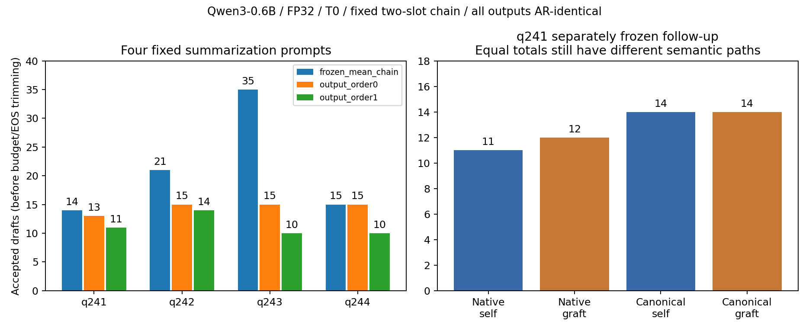

# q241–q244真实跨任务批次与首个canonical跟进

2026-10-14。依据[原草案PLAN](PLAN.md)及[真实执行增补](EXECUTION_PLAN.md)完成四个原生Run、16输出和20次固定窗口诊断；全部独立AR一致、无context缩短，来源/输入/model/有效因素/Study门通过。原始PLAN和checker协议的“未运行”是当时状态，未修改或重签；本报告记录实际执行。source670c744e0535dcad，ModelScope11文件实际hash、Qwen3-0.6B tied/FP32/eager/T0、100新token预算、static[1,1]/k2、beta.9/beta_prime.99，原生runtime默认与原配方保持。

## 原生与固定双向结果

| qid | prompt / new tokens | 输入accepted | 零阶 | 一阶 | 固定根 | 一阶←零阶 | 零阶←一阶 | 一阶原值 |
| --- | --- | ---: | ---: | ---: | ---: | ---: | ---: | ---: |
| 241 | 692 / 100 | 14 | 13 | 11 | 716 | 12 | 10 | 11 |
| 242 | 647 / 100 | 21 | 15 | 14 | 658 | 18 | 14 | 14 |
| 243 | 595 / 100 | 35 | 15 | 10 | 600 | 9 | 17 | 10 |
| 244 | 901 / 90 | 15 | 15 | 10 | 905 | 9 | 10 | 10 |
| 汇总 | 390 new / cell | 85 | 58 | 45 | — | 48 | 51 | 45 |

接受数沿用原生所有深度draft验证计数、在预算/EOS最终裁剪前统计，不能把它们直接当作实际提交token数或速度。q242零阶15accepted+85calls大于99committed的末端预算现象按原始口径保留；合法depth2证据还要求对应AR第二target实际存在。部分输出达到100预算，结论只覆盖这些有限轨迹，未扩长或换prompt。

全部四条都有自然语义路径差异，八个移植方向都改变接受总数；一阶←零阶两增两减，零阶←一阶一增三减。不是一阶稳定收益：本批原一阶45低于零阶58和输入85，累计16个开发单位（12translation+4summarization）为输入145/零103/一92，仅描述性汇总，不做随机样本概率、统计显著性、单seed稳定性或任务全面泛化结论。

## 可核验证伪与状态边界

[批次hypotheses](hypotheses_v1.json)由冻结checker实际运行：H1=observed；四条全部可行，无infeasible替代null。H3=not_falsified_in_captured_native_or_transfer_windows，没有满足同位、同一正确第一AR候选、可用第二target、非first-EOS且实际depth2改变的见证；不能把第二margin、未对齐root或预算外接受当作见证，也不能确认全局first-slot-only解释。该JSON的H2=not_tested是原批次状态，后续另有独立合同与证据，原JSON保留。

[固定window选择](window_selection_v1.json)仅按原choose_window规则、在logits/hidden观察前冻结；没有增根、gain搜索、替换prompt或逼迫旧owner路径。完整[移植记录](transfer_diagnosis_v1.json)保留每个原始／新／未访问root、局部损失和收益、两槽rank合法性、真source owner和所有语义trace；[离线核验](analysis_v1.json)重新检查只换[0,1]以及状态equality字段对应真实张量。

后期同位state经常不再逐元素相同：八移植的最大anchor delta约3.81e-5至7.63e-5，一阶最大velocity delta約3.58e-6至8.11e-6；零阶velocity一直为0。它们在完整AR相同的不同块/owner计算路径下出现，不把全部效应概括为纯proxy中介，也不因幅度小就忽略。原值回填的全trace/state保持原值，错误第一槽/EOS/缺target/重复格/失败质量标志都有明确拒绝门。

## 首个阳性q241：canonical量化预测未保持

按原跟进准则选第一file-order有接受变化的可行单位q241，一阶←零阶、entry716、原11→12；另写[CANONICAL_PLAN](CANONICAL_PLAN.md)，在任何canonical计算前冻结，未把新格子附加到原生Study或重签其产物。

| 对照 | accepted | decode calls |
| --- | ---: | ---: |
| native self | 11 | 88 |
| native graft | 12 | 87 |
| canonical self | 14 | 85 |
| canonical graft | 14 | 85 |

native两格精确复现旧诊断全部captured张量与全语义路径。一次792-position teacher的所查exact-root cosine最低.999999523，满足预声明>=.99999；每个真实root>716按相同AR-prefix回填native chronological CPU-FP32 anchor/v并核对KV root，输入proxies在每次patch未改。四输出均AR一致，所有captured同位canonical state门通过；teacher和CPU重算本身是数值干预，不是精确实数基准。

[canonical分析](canonical_analysis_v1.json)给出H2局部“接受总数差保持+1”预测的反例：差由+1变0。**canonical self也从11变14，且两个canonical cell完整语义路径仍不同**，所以这不是“移植影响全消失”，更不能据此唯一归因committed微差。当前回填最大anchor约1.89e-4、velocity约1.93e-5，变动可继续影响后续mask/proxy与path；cosine接近1不保证接受轨迹不变。它明确阻止把q178的canonical8/9稳定直接外推到新prompt。[完整canonical记录](canonical_diagnosis_v1.json)保留新旧roots与回填幅度，未虚构未观察位置的hidden。

图由[plot_results.py](../plot_results.py)读取正式native和canonical JSON产生，无新模型forward；[图源hash](figures/source_v1.json)绑定两个来源和图。左图为原生四prompt计数，右图是单独冻结的跟进，不混作原生第五cell，也不以等总数掩盖路径差异。

## 实际资源、来源与复跑

| 原生case | Run ID | make est秒 | 实际Flow秒 |
| --- | --- | ---: | ---: |
| frozen_mean_chain | 743d1f6142b3f3dd | 3 | 42.922 |
| output_order0 | 7e34df29d2881838 | 3 | 36.683 |
| output_order1 | a14c58b5f4a2d4a8 | 3 | 36.232 |
| AR | df90405ec5a03f58 | 3 | 25.882 |

首格校准wall46.159秒、RSS6031347712 bytes、GPU全局7318MiB、可用主存最低9201266688；其余3格launch wall119.064秒、RSS6705946624、GPU7336MiB、最低8286580736，round1且跳过已成功首格。原生16输出共1560newtokens，内部AR审计1170，未超固定预算；make通用视觉容量估计26.5GiB不是实测解码占用，按真实首格校准判断。

20诊断共1950newtokens/1704model forwards，wall91.553秒、RSS4882354176、GPU7272MiB。独立canonical4格400newtokens/349生成forward+1teacher，wall33.264秒、RSS4887367680、GPU6102MiB。均.5s采样，含背景、漏短峰；不当allocator峰或硬件/方法速度排名。

ModelScope缓存仅junction复用，实际11文件/模型digest/输入IDs前后门通过；provider默认master仍不能声称远端immutable revision。transfer raw1894476053 bytes、SHAa69db9e942ff58b7428100a02efeca5edf6fcd8a43b0ba8332a073c06c0bab3f；canonical raw330998213 bytes、SHA0829de37ec82cbfc19f9e7e3d82c4a697d168bccfacc058b23a1d5d4d717d2d9，仅本机.tmp。完整Run/shared/weights/cache/tensors/profiler不入Git，报告只存正式scalar和语义证据。未知的跨环境bit复现仍须新version/Run，原生已成功格不重跑。

## 后续边界

q178本轮[入口Phi与RMSNorm对照](../../output_space_extension/docs/STUDY_REPORT.md)均有有效非零高精度替换，8/9路径保持；局部稳定与本批q241自值变化共同说明不能作全算子/全prompt舍入鲁棒性主张。后续应解释q241 canonical自值变化的首个排序分叉，或在新固定单位上检验H2，先写新target／budget，不逐层搜索有利结果。现阶段保留所有正负结果，不调默认、扩长prompt或以总数相等推断路径等价。

收尾核验：30项针对性测试通过，Ruff通过，mypy检查56个源码文件无错误；5个相关Study的科学source与RPipe provenance冻结门通过，20诊断及Phi/RMS、canonical张量离线复核与旧正式结果逐项一致。新测量工具／协议保留原始字节；旧operator_analyzer快照的Git blob恢复为本机已测量的CRLF字节，仅修复存档换行，不改分析逻辑或历史测量文件。10个精确字节路径的暂存blob与本机文件一致。

未推远程、未开／合PR、未改科学src/default、未删数据。
