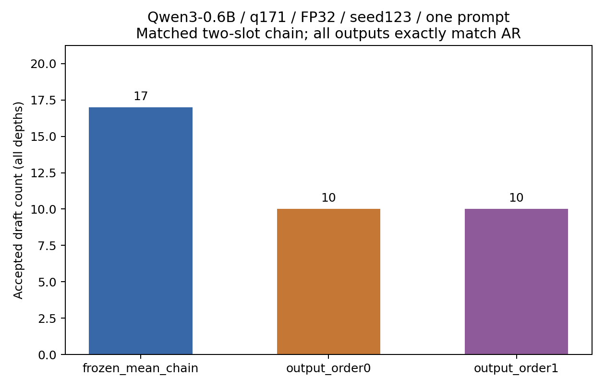

# Study Report: output_space_prerequisite

2026-10-14：四格执行完成，来源/原始证据/正确性/Study完整性质量门通过。输出零阶与一阶均与独立AR逐token一致，但接受数均低于匹配输入均值链；保留负结果，不调参。依据见 [PLAN](PLAN.md)、[精选原始证据](execution_v1.json)、[原生数字表](NUMBERS.md)。

## 条件与结果

ModelScope Qwen3-0.6B同一11文件snapshot，实际模型digest与输入基线一致；FP32/eager/CUDA、q171 translation、非thinking、seed123、T0、100-token预算/EOS。本次static [1,1]、k=2、pruning=false、BC9；旧单槽[14]/BC30的接受数不作匹配对照。q171是固定开发prompt，非独立泛化样本。各Experiment n=1，std=0仅为单Run，未检验H1–H13。

| case | Run ID | new tokens | accepted所有深度 | depth1 | depth2 | decode calls | tau | 实际Flow秒 |
| --- | --- | ---: | ---: | ---: | ---: | ---: | ---: | ---: |
| frozen_mean_chain | df73d3a5f0890541 | 47 | 17 | 11 | 6 | 29 | 1.5862068965517242 | 20.899 |
| output_order0 | 2a070738bc28029b | 47 | 10 | 10 | 0 | 36 | 1.2777777777777777 | 20.877 |
| output_order1 | d69e5e2c8608fec4 | 47 | 10 | 10 | 0 | 36 | 1.2777777777777777 | 18.724 |
| AR | db16f1bceca53451 | 47 | — | — | — | — | — | 18.508 |

三投机case与独立AR均生成47 token，complete/passed=true。committed46不含prefill首token；accepted沿既有预算/EOS截断前口径，不把accepted+calls机械当作最终生成数。AR无投机accepted/tau。输出方法的owner数3、slot数2、FP32状态、最终归一化hidden、均匀输入embedding行范数映射和精确观测行验证均通过。最后owner与root mask不同，owner条件没有被共享向量覆盖；直接tiny测试证明精确提交hidden等于完整因果前缀及无额外forward。

零/一阶各accepted10、depth2为0，均低于输入均值链的17（depth1=11/depth2=6）；本prompt未显示一阶外推增益。它不证明所有输出空间方法无效，也不支持方法优越性；固定beta=.9、beta_prime=.99、gamma/rho=1未由本数据选择，不搜索更好超参。没有实现自适应Kalman、非tied映射或一般分支树。

图源execution_v1.json，三个case各同prompt/seed的n=1；仅画真实all-depth接受计数，无速度排名。复画：`python studies/output_space_prerequisite/plot_results.py`，不执行Run。

## 工程与来源

源码digest 670c744e0535dcad，原生make→launch→process→report完整通过；当前RunID全新，旧input_mask_baseline的v3/v4与报告未改、未重签。实现阶段14针对性状态/hidden/logit/采样/EOS/失败测试、原生CLI篡改owner拒绝，以及完整270 pytest（189.23秒、0 failed/errors/skipped）通过；Ruff与56文件mypy通过。原36格token/AR/接受/KV严格相等，digest12a8ce5363f1118a2dc651805c24b95682e759e5204349c90455a4dcef903493。最终源码wheel/sdist源码外独立target的41条CLI命令全部通过（8原生模板/6专项tiny Run）；两个安装target的新output-hidden实际解码均与AR相等，依赖复用本机GPU环境，不声称从零依赖系统。

Model adapter只对新method请求最后norm输出，临时hook在finally移除，旧方法不改变调用。实际tied权重共享存储检查通过。来源锁绑定新源码/声明/PLAN/输入，raw终验检查mask范数与观测时序。torch2.11.0+cu130、Transformers5.12.1、CUDA13；详细TF32/精度/确定性条件由JSON每Run runtime保存，不声明位级跨设备一致。

## 资源与复跑

沿用同snapshot此前FP32模型仅加载校准作为容量依据；本轮没有把它冒充新测量。round1单GPU串行，OMP/MKL=1，本任务无竞争实验。launch总wall 97.312秒（含模型/源hash和Study终验）；通用make每格估计3秒/26.5GiB是启发式，不是实测。进程树RSS采样峰 6713544704 bytes、线程峰 49，设备全局memory.used采样峰 6019 MiB。0.5秒采样含背景图形占用、可能漏短峰，不等于精确CUDA allocator峰。主存可用量采样最低 9145135104 bytes；逐进程I/O计数见JSON，不等于物理磁盘吞吐。

首次缓存通过本机shared/model/modelscope junction复用已有ModelScope下载，11文件sha256全部核对，未替换或重新下载；该链接不随Git，异机需显式准备同来源并核验manifest。ModelScope不能确认可变master的警告仍保留，不声称不可变provider revision。源码/src与本机raw在feature/output-space-prerequisite；它基于已通过的PR6提交1219a1d，PR6尚未合并，本轮没有新公开推送、合并或发布。

入口为 `python -m spec_mtp make studies/output_space_prerequisite --num-gpus 1 --init-gpu 0 --round 1`，然后原生launch/process/status/logs/report。再次执行必须新version/RunID；不要用make给本轮成功Run签收新source。raw/log/weights与.tmp/output-space-20261014仅本机；正式JSON/图/PLAN/报告随源码保留。NUMBERS仅转换本机log链接为文本，数值不变。

执行完成=true；数值前置质量通过=true；研究优势未获支持。下一阶段应先诊断代理hidden与正确位置hidden的偏差和映射分布，不能由这一个prompt直接扩大矩阵或宣布Kalman成功。
