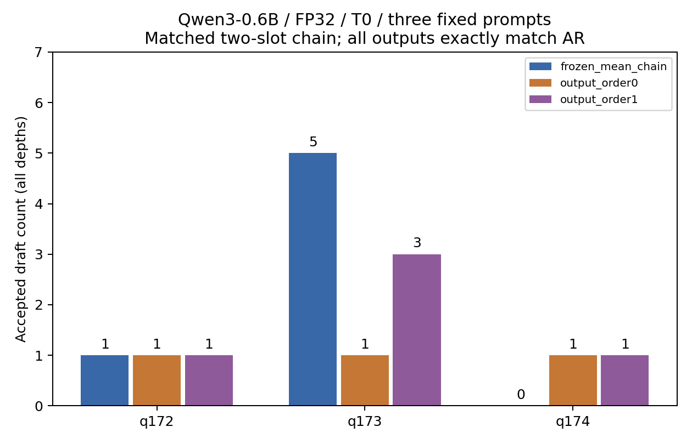
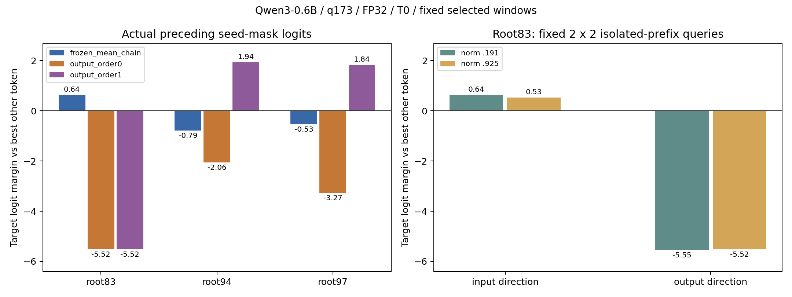

# Study Report: output_space_small_matrix

2026-10-14：按预先固定的q172–q174完成四个新Run（每Run三个prompt），执行与来源/证据/正确性/Study完整性门均通过。三种投机方法的9份输出和独立AR的3份输出逐token相同，没有context-limit缩短。结果是小样本混合观察：一阶在q173比零阶多接受2个draft，但仍少于输入链；q174两输出方法各胜输入链1个。不能把q171负结果或这三条新观察直接推广。

## 固定协议与原始证据

[PLAN](PLAN.md)在执行前声明选择、预算、停止门和匹配前缀分析；[prompt manifest](prompts_manifest.json)冻结数据hash、qid、文本及独立tokenizer渲染后的输入IDs。[执行原始精选](execution_v1.json)、[原生NUMBERS](NUMBERS.md)、[轨迹诊断](trajectory_diagnosis.json)保存所有结果而非只保留最好的prompt。

模型同一ModelScope Qwen3-0.6B、实际tied权重、FP32/eager/CUDA、非thinking、T0、100-token/EOS、seed123。prompt窗口translation skip11/take3，输入长度39/69/32；原生per-prompt生成器seed123/124/125，T0不依赖抽样。匹配unpruned static[1,1]链、k2/BC9、原输入均值/输出0/1配方；beta=.9、beta_prime=.99、gamma/rho=1无改动。源码670c744e0535dcad及数据/modelhash均与前置阶段绑定一致。不是旧BC30/[14]的跨协议比较。

## 每prompt结果

| qid | case | new tokens | accepted所有深度 | depth1 | depth2 | decode calls | tau |
| --- | --- | ---: | ---: | ---: | ---: | ---: | ---: |
| 172 | frozen_mean_chain | 14 | 1 | 1 | 0 | 12 | 1.083333 |
| 172 | output_order0 | 14 | 1 | 1 | 0 | 12 | 1.083333 |
| 172 | output_order1 | 14 | 1 | 1 | 0 | 12 | 1.083333 |
| 173 | frozen_mean_chain | 33 | 5 | 4 | 1 | 27 | 1.185185 |
| 173 | output_order0 | 33 | 1 | 1 | 0 | 31 | 1.032258 |
| 173 | output_order1 | 33 | 3 | 3 | 0 | 29 | 1.103448 |
| 174 | frozen_mean_chain | 13 | 0 | 0 | 0 | 12 | 1.0 |
| 174 | output_order0 | 13 | 1 | 1 | 0 | 11 | 1.090909 |
| 174 | output_order1 | 13 | 1 | 1 | 0 | 11 | 1.090909 |

独立AR对应生成14/33/13 token。三个prompt各先prefill提交1token，合计new60、committed57。汇总accepted为输入链6、零阶3、一阶5，decode calls为51/54/52；pooled tau按57除各自calls计算，不平均不同长度prompt的tau。输入链唯一depth2接受发生在q173（1个），两输出depth2均0。接受数沿既有截断前口径，不等于额外新token；没有BLEU或参考译文质量结论，只验证与当前目标模型AR相同。

各方法单Run/单seed，n=3是相邻prompt数量，并非三个seed重复。NUMBERS里的std=0来自单Run。样本数量和选择不足以作显著性、稳定收益或跨域泛化结论；未做性能排名。

图源execution_v1.json，每个柱是一prompt/一方法的原始all-depth接受计数。重画 `python studies/output_space_small_matrix/plot_results.py`，不执行Run。

## 匹配前缀轨迹诊断

分析按同qid、同absolute root_position对齐，并验证完整AR输入/output前缀相同及cache_before相同；不同方法的第i次forward往往不是同一个前缀，因此不按step编号匹配。可重建脚本 [analyze_trajectories.py](../analyze_trajectories.py) 从正式执行JSON复算并要求与既存诊断逐项一致，没有新增模型forward。

- q172：三方法accepted都1，但输入与输出匹配的11个根位置中有2处接受长度不同：root41输入1/输出0，root43输入0/输出1。一致汇总并不意味着同一位置命中。零阶与一阶的12个根及完整验证/提交/KV轨迹一致。
- q173：零阶与一阶29个共同根中只有root94与97接受长度不同，均为零阶0/一阶1。每次一阶连续提交2token、零阶仅1，后者还需要root95/98两次额外decode，所以实际calls31→29且总accepted1→3。这个观测定位了调用差异，未证明由EMA速度方向或代理hidden校正直接造成。两方法所有29个共同根的owner差异范数统计不同。
- q173：输入链在root79/83/88/92分别接受1/2/1/1，输出一阶均0；一阶又在root94/97各接受1而输入均0。不同方法命中不同区间，输入最终5、一阶3，不能只展示一阶胜的两个区间。
- q174：共同root42输入0/输出1；输出提交句号token13及bonus EOS151645并终止，输入需要下一root43取EOS。因而输出11calls、输入12calls；收益集中在该句末位置，不能宣称整段机制优势。

完整未共同访问根列表、停止标志、提交token与两两比较都在trajectory_diagnosis.json保留。矩阵本身的保存数据缺草稿logits、完整mask向量及同位proxy/exact hidden配对；下方按新诊断合同补充固定窗口测量，不能从矩阵原数据补造这些量。范数差异是统计量差异，不声称证明完整向量关系。

## Run与资源

| case | Run ID | est秒 | 实际Flow秒 |
| --- | --- | ---: | ---: |
| frozen_mean_chain | 4f87c26584a1a6a1 | 3 | 21.056 |
| output_order0 | 8abcc1a22086bcc7 | 3 | 21.757 |
| output_order1 | 824b1fe0b8578349 | 3 | 20.838 |
| AR | 632786e445329297 | 3 | 19.321 |

使用原生make→launch→process→report、round1单GPU串行，权重11文件hash复核且同snapshot通过cache junction复用，Run保持local_files_only。启动前可用主存15.19GiB、GPU21GiB以上；既有同模型串行容量校准复用而非冒充新测量。launch总wall 102.159秒（含初始化/hash/Study终验），make每格3秒/26.5GiB为启发式，不是实测。0.5秒采样进程树RSS峰 6710669312 bytes、线程峰 49、GPU全局memory.used峰 5267 MiB、系统可用主存最低 11050160128 bytes。包含背景占用且可能漏短峰，不等于CUDA allocator峰；I/O计数不等于物理吞吐。OMP/MKL1，无本任务竞争实验。完整runtime/TF32及采样边界见JSON。

实验源码与算法未修改；旧270项、36格严格轨迹与wheel/sdist源码验证仍对应同一源码digest，不重跑其硬件任务冒充本轮。仅新增Study声明/报告/离线工具，完成本轮声明展开、来源锁/四Run原始证据、脚本复算和文档/静态检查。旧q171/失败/权重/raw未覆盖或重签。本地分支feature/output-space-prerequisite，不推送、不合并、不删数据。

## 结论与可复现下一步

执行完成=true；质量通过=true；稳定方法优势尚未建立。q173首次出现一阶超过零阶的两个具体匹配前缀，q174有单个句末优势，整体输入链在此三prompt仍领先。随后已冻结q173 root94/97与输入领先的root83，按独立instrumentation/尺度合同补测，保持token/接受链和科学配方不变；实际测量与有限解释见下节，不直接扩完整矩阵。

复跑本矩阵：准备同ModelScope来源后改新version，`python -m spec_mtp make studies/output_space_small_matrix --num-gpus 1 --init-gpu 0 --round 1`，再launch/process/status/logs/report。正式JSON/图/PLAN/报告与只读分析/图工具可随源码复现；Run/raw/log/weights和.tmp/output-matrix-20261014仅本机，不随clone。NUMBERS仅将本机log引用改为文本，数值不变。

## q173固定窗口测量与反事实对照（2026-10-14）

上述矩阵之后，按独立 [WINDOW_PLAN](WINDOW_PLAN.md) 固定root83/94/97，只读观察原SpecDecoder/provider/model；再按 [SCALE_PLAN](SCALE_PLAN.md) 对root83作固定2×2方向/范数介入。[窗口证据](window_diagnosis_v1.json)、[尺度证据](scale_diagnosis_v1.json)记录源码/tool/PLAN/原矩阵/本机张量SHA与实际runtime。三次q173重放各33token，完整output/接受/提交/KV与原生Run一致；observer模型调用次数28/32/30均等于1+原decode_calls。另有1个完整AR序列teacher-force与9个隔离prefix+seedmask前向；尺度对照仅4个前向、0新生成token。没有新增正式接受格子、重签旧Run或改变科学src/参数。

### 起草证据的正确时序

root p的当前draft由上一块最深已接受owner的mask logits给出，其第一个mask输入位置为p、预测目标为AR[p+1]。它不是当前块新构造的mask。三个窗口都核对seed位置[p,p+1]、实际草稿embedding、同位精确hidden，以及隔离正确prefix+实际seedmask的top1/hidden一致性。精确hidden与teacher、代理hidden与隔离seed的cosine均>=.99999；原块与隔离块的target margin差异绝对值最大约1.72e-5，没有跨过任何此处的margin符号。

| case | root | seed来源block root | owner | slot1正确target margin | target概率 | proxy/exact cosine | 相对L2误差 | 接受长度 |
| --- | ---: | ---: | ---: | ---: | ---: | ---: | ---: | ---: |
| frozen_mean_chain | 83 | 82 | 0 | 0.639807 | 0.469612 | 0.456241 | 0.920022 | 2 |
| frozen_mean_chain | 94 | 92 | 1 | -0.78651 | 0.111423 | 0.557233 | 0.856108 | 0 |
| frozen_mean_chain | 97 | 96 | 0 | -0.531294 | 0.175262 | 0.471613 | 0.895813 | 0 |
| output_order0 | 83 | 82 | 0 | -5.517139 | 0.003209 | 0.330888 | 1.101792 | 0 |
| output_order0 | 94 | 93 | 0 | -2.061214 | 0.045804 | 0.447117 | 1.074323 | 0 |
| output_order0 | 97 | 96 | 0 | -3.272995 | 0.02665 | 0.173248 | 1.114228 | 0 |
| output_order1 | 83 | 82 | 0 | -5.517139 | 0.003209 | 0.330888 | 1.101792 | 0 |
| output_order1 | 94 | 93 | 0 | 1.941534 | 0.579934 | 0.526143 | 0.934342 | 1 |
| output_order1 | 97 | 96 | 0 | 1.837038 | 0.699188 | 0.793944 | 0.640971 | 1 |

margin是正确target logit减去最高其他token logit（T0），不是速度或接受率。root94/97处，一阶target margin从零阶的-2.0612/-3.2730变为+1.9415/+1.8370，正确target成为top1，具体解释了此前两次额外贪心接受；隔离同prefix重放的top1相同，差异不来自当前prefix错位或约1e-5的块计算差异。此处两个输出mask范数同为约.925，第一seed向量的零/一阶cosine分别.98035/.24585（相对L2=.19823/1.22813）。proxy/exact误差也同时降低，但未对误差作独立介入，不能将相关性等同于滤波机制已证明。

root83则输入margin+.63981、输出0/1均-5.51714，两输出的第一seed向量逐元素相同，实际top1为11而正确target为7602。虽其第二slot对AR第二target11有较高概率，第一草稿前缀已错，这个second-slot AR对照无效，不能记为真实depth2命中。所有second_AR_prefix_valid标志保留；输入在该位置两层均合法接受。

### 分开方向与范数

root83实际输入/输出seed范数=.1912895/.9250697，原观察同时改变方向与范数。固定四查询只交叉这两个已观察方向和两种已观察范数，没有搜索、挑最优或替换科学默认值；观察组合的top1复现，margin差<=1e-3。

| seed方向 | 范数 | top1 ID | 正确target margin | target概率 | 原观察组合 |
| --- | ---: | ---: | ---: | ---: | --- |
| input | 0.19129 | 7602 | 0.639812 | 0.469613 | True |
| input | 0.92507 | 7602 | 0.531311 | 0.405206 | False |
| output | 0.19129 | 11 | -5.545199 | 0.002923 | False |
| output | 0.92507 | 11 | -5.517136 | 0.003209 | True |

在这一个固定prefix和这两个尺度下，输入方向均使target7602为top1，输出方向均使11为top1；缩小输出范数不能修复这里的first-slot错误，增大输入范数也未使其失败。可排除“这两个尺度中的范数差异单独解释root83失败”，方向/内容在该局部对照中决定了正确target是否排第一。它不排除其他尺度、位置或prompt的范数效应，不是完整decoder配方的接受改善试验，更不授权将范数事后调为较优值。

### velocity的局部结构检查

[事后离线结构证据](structural_diagnosis_v1.json)从保留张量复算实际原provider，无模型前向。这里两个输出方法的三窗口seed来源均为owner0，其第一个slot(j=0)为Phi(proxy[0])；一阶来源velocity norm约8.04/8.00/10.74，但将它置零后这个first-slot向量完全相同，原seed重构max_abs_error<=2.98e-8。因此不能把root94/97的收益说成当前velocity直接加到了slot1；直接变化是此前代理hidden及其映射方向，velocity可通过更早slot/owner历史传播，具体起点和中介路径还未逐步介入确认。复算入口 [analyze_windows.py](../analyze_windows.py) 需要本机原selected_tensors.pt并检查SHA，拒绝用未知张量覆盖记录。

图源上述正式JSON：左图为原preceding seed logits，右图为root83四个隔离prefix查询；不是总体接受收益、置信区间或速度图。重画：`python studies/output_space_small_matrix/plot_windows.py`。

### 执行与保留边界

窗口测量wall15.621秒，进程RSS采样峰6102249472 bytes/GPU全局5731MiB；尺度测量wall12.170秒，RSS5550583808 bytes/GPU5575MiB，线程峰均13、OMP/MKL1。均0.5秒采样，包含背景占用且可能漏短峰，不作精确allocator或性能结论。工具会同步复制张量，因此计时不可与正式矩阵排名。模型/11文件snapshot/runtime/srcdigest在测量前后均核验一致。6项observer清理/原轨迹/时序/margin/固定交叉测试通过；新增工具与本轮文档静态检查另有日志，不把旧270全量改写为新的全量计数。

本机张量/全词表logits存在.tmp/output-windows-20261014-v1，sha47166a3b41e0c00ed39110593fe7f83b20323c2e3714fe0355f2a43aaa9dc14c；不随Git。正式scalar JSON和复跑工具入库，无权重/凭据导出。测量命令见两个工具docstring，out必须新目录；源码/模型/原矩阵不一致即停止并保存失败，不自动重签。未推送、合并或删除任何原始证据。

这一步将接受计数差异推进到同prefix的实际mask输入与候选margin，并用固定尺度介入排除一个局部替代解释。保留其有限范围；未实现自适应Kalman、未优化映射/超参、未扩大完整矩阵。

## q173单次历史代理移植（2026-10-14）

按测量前冻结的 [TRANSFER_PLAN](TRANSFER_PLAN.md)，只在root83返回的mask张量中替换owner0第二槽（零基[0,1]），进行一阶←零阶、零阶←一阶、以及一阶原值回填三次重放。固定donor来自已保留窗口张量；没有修改committed状态、其他mask、默认配方或科学源码。转移的是完整向量，范数分别.925069749/.925069809，L2差.053660285；未再归一化，不能称为数学上严格等范数的纯方向介入。这里的差异主要为方向，范数仅有浮点末位差异；本轮不靠该近似作跨尺度结论。

[干预证据](transfer_diagnosis_v1.json)保留完整实际验证/提交/KV轨迹、source/model/runtime/PLAN/tool/raw绑定及全部预定窗口。[离线路径核验](transfer_path_diagnosis_v1.json)来自本机张量的逐元素比较，无新增forward。新工具不复用原观察器的baseline接受路径：先按实际root步进确定preceding seed owner，再核对真实trace；五个预定根83/84/86/94/97本轮全部访问，没有强制访问或替换窗口。

| q173方法/干预 | root94正确target margin | root97正确target margin | accepted | decode calls | 命中根 |
| --- | ---: | ---: | ---: | ---: | --- |
| 原零阶（已保存矩阵） | -2.061214 | -3.272995 | 1 | 31 | 84 |
| 一阶原值回填（完整复现原一阶） | 1.941534 | 1.837038 | 3 | 29 | 84、94、97 |
| 一阶，仅root83第二槽换为零阶 | -2.061214 | -3.272995 | 1 | 31 | 84 |
| 零阶，仅root83第二槽换为一阶 | 1.941534 | -1.643641 | 2 | 30 | 84、94 |

三次均生成33token，逐token与原独立AR一致，无context缩短。干预前及root83完整语义轨迹一致，root83的preceding first seed未变；只修改一次指定provider返回槽位，其他坐标逐元素不变。原值回填完整token/接受/KV与原一阶一致。两真实移植允许后续接受路径变化，结果全部保留，没有将它们当作新正式Run或稳定收益。

### 历史传播与当前速度的边界

一阶←零阶的root84 incoming proxy0未变，proxy1相对一阶原值回填L2变化1.404191；root84仍接受一个draft，于是选择owner1的mask输出。其root86 incoming proxy0变化3.522655。保留张量逐元素证明两个边：root83 owner0 mask hidden→root84 incoming proxies，以及root84 owner1 mask hidden→root86 incoming proxies；对应mask输入→下一块实际seed输入也逐元素相同。该结果支持这次早期第二槽扰动沿原decoder代理历史传播，改变后续first-seed候选，而非观察器强行沿旧路径取owner。

同一一阶recipient在83/84/86/94/97五个固定根的committed anchor和velocity与原值回填均逐元素相同，但root94/97 first seed向量及完整词表seed logits变为原零阶对应值（max_abs_delta=0），两次一阶额外接受消失。由此可收紧为：在本q173干预中，保持这些同位committed速度状态不足以保持原两次命中；单个历史代理入口能够改变结果。此结论不说明整个解码过程velocity无作用，也未单独隔离所有中间slot/owner。

反向零阶←一阶时，五窗口committed velocity均为零，root94 first seed及完整词表logits与原一阶逐元素相同，并新增一次接受；root97未恢复，仍负margin。因而当前非零committed velocity并非本root94命中的必要条件，这次历史移植在零阶上下文中足以恢复root94，但不足以恢复root97或完整一阶结果。不能把前一方向的完整消除和后一方向的部分恢复概括成双向完全等价，不能推广为普遍EMA归因。

这仍是单qid、单seed124、单干预位置和五个有限窗口。两方法的历史与后续其他槽位仍不同，没有连续全位置中介观测或跨prompt复现；原接受差异与当前速度的关系已被局部介入收紧，尚未建立全局机制或优化配方。后续扩展应先冻结其他prompt/失败窗口，再按同样单槽和原值回填门复验；本轮不据负/正结果追加根搜索。

### 复现与资源

实测wall15.710秒，0.5秒采样进程树RSS峰5568364544 bytes、线程13、GPU全局峰5557MiB、系统可用内存最低12413997056 bytes；包含背景占用并可能漏短峰，不作性能/allocator结论。实际模型forward32/31/30（合计93）等于三case各1+实际decode_calls，新增token99，辅助forward0，低于预声明300-token预算。源码670c744e0535dcad、模型digest/runtime、原Run inputs/config/raw、11文件snapshot及PLAN/tool在前后核验一致。

复跑工具 [diagnose_proxy_transfer.py](../../../tools/diagnose_proxy_transfer.py) 用同一ModelScope缓存和保存窗口证据，out必须新目录；失败保留且停止。离线重核 [analyze_transfers.py](../analyze_transfers.py) 的命令见docstring，既存正式JSON不一致则拒绝覆盖。干预张量19588880 bytes，仅本机.tmp/output-transfer-20261014-v1，SHA473a7f470fc8158a0627e9b5e3f80216a75a73fd04f7fe112d78021fd1089b33，不随Git。3项新小模型测试覆盖单槽范围/实际owner/逐token一致/原值回填/异常清理；文档和静态检查另存日志。没有改旧NUMBERS、重签原Run、推送、合并或删数据。
