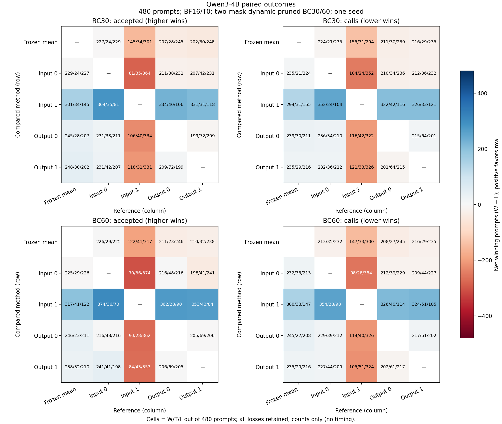

# Qwen3-4B BF16 paired report

完整验收：True；已完成 11/11。

原生Run及Study process全部通过；10个Spec Run共4,800条prompt、809,118个提交token的验证前向argmax自检全过。独立AR仅运行一次480条，不冒充Spec自检。两个预算均由输入一阶取得最高总accepted与最少主calls；输出零阶/一阶相对frozen mean和输入零阶有小幅总量改善，但均落后输入一阶。输出一阶相对输出零阶未显示稳定联合收益。

[原生终验证据](native-process-evidence-v1.json)绑定process、来源、正式JSON及图的SHA；[原生数字表](NUMBERS.md)保留Experiment/Run统计。正式JSON与真实图重复读出后字节一致，图已目检；[集成与CI记录](https://github.com/DreamSoul-AI/denoising-speculative-decoding/pull/12)。

| Cell | native | accepted | calls (prefill+decode) | new tokens | pooled τ | prompt mean τ | AR exact/n (rate) | argmax checked |
| --- | --- | --- | --- | --- | --- | --- | --- | --- |
| AR | succeeded | n/a | 81880 | 81880 | n/a | n/a | n/a | n/a |
| 30/frozen_mean | succeeded | 23188 | 57825 | 80929 | 1.4028947597872525 | 1.4759377696433031 | 184/480 (38.33%) | 80929 |
| 30/input_zero | succeeded | 23926 | 56938 | 80787 | 1.422420206170959 | 1.4798374864700174 | 168/480 (35.00%) | 80787 |
| 30/input_first | succeeded | 27371 | 53668 | 80898 | 1.5119575844175377 | 1.5430074255436272 | 175/480 (36.46%) | 80898 |
| 30/output_zero | succeeded | 24382 | 56577 | 80877 | 1.4331782448259265 | 1.483601057341492 | 177/480 (36.88%) | 80877 |
| 30/output_first | succeeded | 24573 | 56716 | 81209 | 1.4355395120563341 | 1.4825319338594185 | 184/480 (38.33%) | 81209 |
| 60/frozen_mean | succeeded | 26913 | 54197 | 81006 | 1.4990785040117653 | 1.5710319322666075 | 165/480 (34.38%) | 81006 |
| 60/input_zero | succeeded | 27523 | 53309 | 80733 | 1.519108822805656 | 1.5789239399696458 | 167/480 (34.79%) | 80733 |
| 60/input_first | succeeded | 31611 | 49875 | 81307 | 1.6363397104970139 | 1.6658595242934762 | 162/480 (33.75%) | 81307 |
| 60/output_zero | succeeded | 27828 | 52896 | 80620 | 1.5289224664224663 | 1.5791263993793005 | 172/480 (35.83%) | 80620 |
| 60/output_first | succeeded | 27903 | 52951 | 80752 | 1.5298355281965277 | 1.5762885704720164 | 161/480 (33.54%) | 80752 |

相对独立AR的逐prompt调用数比较；calls越低越好。AR没有draft接受数，该指标不适用。输出长度及AR首分叉单列，不能将不同长度的调用数直接解释为等长加速。

| Cell | calls vs AR W/T/L | Δcalls vs AR |
| --- | --- | --- |
| 30/frozen_mean | 469/1/10 | -24055 |
| 30/input_zero | 476/0/4 | -24942 |
| 30/input_first | 477/0/3 | -28212 |
| 30/output_zero | 472/1/7 | -25303 |
| 30/output_first | 475/0/5 | -25164 |
| 60/frozen_mean | 475/1/4 | -27683 |
| 60/input_zero | 478/0/2 | -28571 |
| 60/input_first | 478/0/2 | -32005 |
| 60/output_zero | 476/0/4 | -28984 |
| 60/output_first | 477/0/3 | -28929 |

以下胜负指第二方法相对第一方法；accepted越高越好，calls越低越好，两个指标分别判定。

| first → second | accepted W/T/L | calls W/T/L | Δaccepted | Δcalls | Δnew tokens |
| --- | --- | --- | --- | --- | --- |
| 30/frozen_mean → 30/input_zero | 229/24/227 | 235/21/224 | 738 | -887 | -142 |
| 30/frozen_mean → 30/input_first | 301/34/145 | 294/31/155 | 4183 | -4157 | -31 |
| 30/frozen_mean → 30/output_zero | 245/28/207 | 239/30/211 | 1194 | -1248 | -52 |
| 30/frozen_mean → 30/output_first | 248/30/202 | 235/29/216 | 1385 | -1109 | 280 |
| 30/input_zero → 30/input_first | 364/35/81 | 352/24/104 | 3445 | -3270 | 111 |
| 30/input_zero → 30/output_zero | 231/38/211 | 236/34/210 | 456 | -361 | 90 |
| 30/input_zero → 30/output_first | 231/42/207 | 232/36/212 | 647 | -222 | 422 |
| 30/input_first → 30/output_zero | 106/40/334 | 116/42/322 | -2989 | 2909 | -21 |
| 30/input_first → 30/output_first | 118/31/331 | 121/33/326 | -2798 | 3048 | 311 |
| 30/output_zero → 30/output_first | 209/72/199 | 201/64/215 | 191 | 139 | 332 |
| 60/frozen_mean → 60/input_zero | 225/29/226 | 232/35/213 | 610 | -888 | -273 |
| 60/frozen_mean → 60/input_first | 317/41/122 | 300/33/147 | 4698 | -4322 | 301 |
| 60/frozen_mean → 60/output_zero | 246/23/211 | 245/27/208 | 915 | -1301 | -386 |
| 60/frozen_mean → 60/output_first | 238/32/210 | 235/29/216 | 990 | -1246 | -254 |
| 60/input_zero → 60/input_first | 374/36/70 | 354/28/98 | 4088 | -3434 | 574 |
| 60/input_zero → 60/output_zero | 216/48/216 | 229/39/212 | 305 | -413 | -113 |
| 60/input_zero → 60/output_first | 241/41/198 | 227/44/209 | 380 | -358 | 19 |
| 60/input_first → 60/output_zero | 90/28/362 | 114/40/326 | -3783 | 3021 | -687 |
| 60/input_first → 60/output_first | 84/43/353 | 105/51/324 | -3708 | 3076 | -555 |
| 60/output_zero → 60/output_first | 206/69/205 | 202/61/217 | 75 | 55 | 132 |

accepted为EOS/预算裁剪前候选接受数；committed及τ包含bonus、按裁剪后实际解码提交数计算，不含prefill首token。argmax审计含首token且必须全过；独立AR首分叉和输出长度全部保留，不作为失败门。AR参考不冒充Spec验证argmax审计。

模型、forward及最终mask为BF16；输出EMA/范数沿用原生FP32内部状态。不同方法β等沿用预先定义配方，不声称差异仅由输入/输出空间造成。单seed、固定480条，不推断总体优越或测速收益；零计时字段为占位。

逐prompt计数、两两赢平输及AR首分叉见[paired_evidence_v1.json](paired_evidence_v1.json)。

[冻结计划](<../../../docs/研究计划 Denoising Speculative Decoding.md#legacy-studies-qwen3-4b-bf16-five-methods-docs-plan>)；原始tokens、完整Run和权重仅本机保留。

图：行方法相对列方法，格内为W/T/L，颜色为净赢数W−L，固定范围±480；接受数越高越好，调用数越低越好。两个预算的全部方法对照和输局均保留，对角不作比较。独立AR调用数、一致率、首分叉与输出长度另列于表格及正式证据；本图不表示测速或总体显著性。

## 结果解释与适用范围

输入一阶相对输入零阶：BC30总accepted+3,445、主calls−3,270，接受数W/T/L=364/35/81、calls352/24/104；BC60为+4,088/−3,434，接受数374/36/70、calls354/28/98。这是本次固定配方、固定样本中的比较，不代表所有输入方法或总体排序。

两种输出方法在两个预算下，相对frozen mean和输入零阶均增加总accepted并减少总calls，但逐prompt反例仍多。例如BC60输出零阶相对输入零阶的接受数胜负次数同为216，尽管总accepted+305、calls−413。两个输出方法相对输入一阶均更差；不能将“相对mean基线有小幅总量收益”写成输出空间普遍优于输入空间。

输出一阶相对输出零阶：BC30总accepted+191、calls+139、new tokens+332，接受数W/T/L=209/72/199、calls201/64/215；BC60为+75/+55/+132，接受数206/69/205、calls202/61/217。两预算pooled τ均略升，prompt mean τ均下降，且总calls增加；新增速度项未在这批样本显示稳定联合收益。不同长度与路径的调用数差不解释为同输出加速。

独立AR逐token一致率为各格161–184/480（33.54%–38.33%），全部首分叉位置和长度差已保留；它们仅作诊断，未触发重跑或数值机理分析。正确性结论只覆盖提交token等于对应验证forward argmax的自检，不宣称与独立AR完全一致。

本次为双mask动态剪枝树BC30/60（draft节点9/19）；区别于前置8B Table1的BC60单mask主配置。4B的ESP frozen mean与论文λ=.1 updating mean也不同。所有方法沿用预先冻结配方，β与内部状态dtype并未做相同化控制，不能把差异只归因于空间或阶数。真实tied-storage检查通过，无逆映射；模型文件内容SHA已与魔搭核对，缓存immutable revision身份仍未确认，见[来源核验](modelscope-content-verification-v1.json)。不从单seed固定480条外推显著性或测速收益；前置8B论文τ目标未复现的负结果保留。
