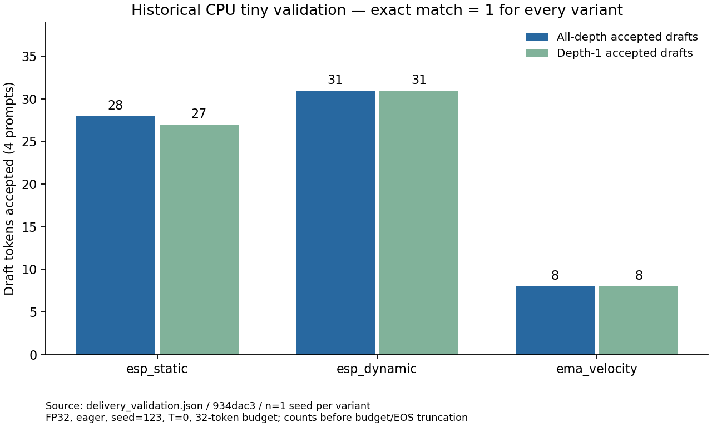

# Study Report: smoke

本报告保留 2026-10-13 各实现提交/version 的原验收事实。Study 结构重写不新增研究矩阵、不重新签收历史数字；可复用合同见 [PLAN](PLAN.md)。

## 一、摘要

- 目标：接通固定 RPipe v0.3.0 的真实阶段职责，保留 ESP/EMA/AR/alignment 研究语义，拒绝无证据的成功。
- 历史验收实现提交：`934dac3fd3b1662664ebf71d8317b49183e22f0b`（含此前 `7c89d7c` 的适配），工作分支 `refactor/spec-rpipe`；上游固定 `804b3823ab6d2af46cbda1a65688ca8b76c60b22`。接入主体在本次开始前的 c3263c0 已存在，本次只补齐缺口。
- 最终结果：229 passed；固定版本 Ruff/mypy 通过；旧/新 36 格 token/接受/cache 完全相同，555 格改动前/后 fingerprint 完全相同。CPU/CUDA tiny 三 variant 均 exact-match=1，wheel/sdist 各通过实际安装与阶段链。
- 边界：真实预训练模型、ModelScope 下载、严格解码恢复、GPU 并发容量、完整大模型矩阵未验收；没有重跑历史正式接受数。

最终提交的阶段链、包哈希与 Run 见 [delivery_validation.json](delivery_validation.json)。此前适配提交的详细机器数字与来源见 [migration_validation.json](migration_validation.json)，固定原始 token/接受/cache 参考见 [tiny_decode_reference.json](tiny_decode_reference.json)。它们是正式 tiny 验收证据，不是历史论文实验的新结果。

## 二、实现与兼容边界

RPipe 提供 Factory/Registry、配置展开、调度、六阶段、Tracker、日志、result/provenance 和 readout。专项 prepare 经 recipe 注册和构造检查；execute 保存真实观测；collect 计算 CSV/Tracker；summarize 执行成功门；write 再核对来源、配置、输入、权重和运行条件，库才定稿；process 只读当前 index 并复验证据、声明 factors/seeds 和来源一致性。

vendored 的 101 个上游文件仅 Windows torch-first `__init__.py` 有差异；ORIGIN 和 MIT 许可证额外保留。Ruff 的四文件 F401 例外只解决公开转导出与下游 lint 的冲突，不修改上游源码。make 的 torchvision-only endpoint 边界通过已有 prepare_shared:false 适配；Run prepare 继续 shared/data 与 shared/model。[问题与兼容记录](../../../docs/bugs.md) 区分上游边界和下游缺陷。

保留 decoder 的 mask/autograd/树/cache/位置/attention/接受/EOS/预算逻辑，trace 只读取已算出的状态；legacy evaluate/test 调用仍可用。历史 history_extrapolation 的报告与切片在 c3263c0 前已迁入 docs/history-extrapolation.md 和 datasets/spec_bench，核对 Git rename 和章节后未重复搬迁。hw_probe 是 2026-10-07 的旧容量探针，不拿它授权当前并发。现有可执行 Study 是 smoke 与模板；AR/alignment 由同一 recipe 支持并通过实际 CLI 测试。PLD/STAND/LADE 与输出空间研究草案未补写为已实现。

## 三、数值与环境

### （一）旧链与当前链

旧链：Git archive 导出 b1f6191 的 src；当前链：本次适配。用 [validate_migration.py](../validate_migration.py) 在同设备、同依赖上运行三 variant × T={0,0.7,1} × 四 prompt，Python line trace 被动读取接受路径与 KV cache，不改旧源码。36 格全部 token-for-token 等于 AR，完整 token、计数和每步轨迹完全相同，digest `12a8ce5363f1118a2dc651805c24b95682e759e5204349c90455a4dcef903493`。

另用现有 decode_fingerprint 覆盖全部 paper/smoke preset、短上下文与温度的 555 格，改动前工作区和当前链相同：`84d3a1b6fe65811c8094ca545db97d5aa80cb218923197413c56470d66c03ceb`。context-limit 格比较的是工具原有 full-AR 标志；工具记录的 shorter-prefix 不被删掉或改写成 full-AR 相等。实际 Flow 的 context-limit 回归仍按方案 A 对齐已达到的预算。

### （二）提交后的真实 Run

Python 3.13.9，torch 2.11.0+cu130，transformers 5.12.1，NumPy 2.3.5；Windows。CUDA tiny：NVIDIA GeForce RTX 5090 D v2，CUDA 13.0。随机 LLaMA vocab=256/hidden=64/layers=2、四个 synthetic prompt 长 32、seed=123、max_new_tokens=32、T=0、stop_on_eos=false、eager；实际 dtype float32（随机 tiny 原配方），matmul TF32=False、cuDNN TF32=True。没有改真实模型的 bf16/fp32 配方，也没有为了通过改变温度或阈值。

| **设备 / variant** | **Run ID** | **accept_d1** | **accepted** | **new_tokens** | **committed** | **decode_calls** | **τ** | **exact_match** |
| --- | --- | ---: | ---: | ---: | ---: | ---: | ---: | ---: |
| CPU / esp_static | 30528cdb12db5445 | 27 | 28 | 128 | 124 | 97 | 1.278351 | 1 |
| CPU / esp_dynamic | b1aa481f093871ea | 31 | 31 | 128 | 124 | 94 | 1.319149 | 1 |
| CPU / ema_velocity | eac77a3957d6ca55 | 8 | 8 | 128 | 124 | 116 | 1.068966 | 1 |
| CUDA tiny / esp_static | 3bf7ac9df250954f | 27 | 28 | 128 | 124 | 97 | 1.278351 | 1 |
| CUDA tiny / esp_dynamic | b5da1caba330b3e7 | 31 | 31 | 128 | 124 | 94 | 1.319149 | 1 |
| CUDA tiny / ema_velocity | 5bc84e19861a7b71 | 8 | 8 | 128 | 124 | 116 | 1.068966 | 1 |

accept_d1 是深度 1 的接受；accepted 是所有深度的接受（沿用原实现的预算/EOS 截断前统计）。new_tokens 包含 prefill 的第一个新 token，committed 是 decode pass 提交的 token，τ=sum(committed)/sum(decode_calls)，prefill 不进分母。速度与 τ 不替代正确性或研究结论，未做性能排名。旧 tiny 的 27/31/8 是 accept_d1 回归口径，不等同所有深度 accepted。

提交后版本为 commit-7c89d7c-cpu/cuda，源码包 dirty=false，完整 source/模型/input digest 见 JSON。仓库 smoke 另用 rpipe-v030-20261013-final03 运行 make --round 1→launch→process/readout，三 Run 通过，生成 [NUMBERS.md](NUMBERS.md)。首轮 default make 曾派发三个独立 CPU Run；数值对照 probe 与最终 smoke/提交后 tiny 均串行，没有比较竞争资源时的速度。

## 四、失败、静态门与安装

1. 首轮仓库 smoke 的旧锁拒绝新的源码（1 failed/8 passed），旧 Run 3b0724f5e0396351 被库回写 failed；执行前未备份 result，原终态无法确认/恢复。raw/log 未删；后续改隔离目录与新 version，并在薄 CLI 前置来源核对，回归证明拒绝不再改写旧 result。
2. CUDA final02 的原始 exact-match=1，但 `cuda`/`cuda:0` 名称比较产生下游配置漂移误报，Run failed；修复只改有效配置核对，加入别名回归，final03 与提交后新 Run 通过。失败 Run ID 与索引留在正式 JSON，raw/log 保留本机 `.tmp/acceptance-20261013/`。
3. 最终 pytest：227 passed、0 skipped。包含真实 raw token mismatch 在 summarize 拒绝成功、来源新增/删除/修改、配置/输入漂移、证据缺失、子集/seed/混合来源、AR/alignment 实际阶段链。Ruff 0.17.0 passed；mypy 2.4.0 对全部 40 源文件通过。早期本机工具依赖缺失/版本不匹配日志保留，最终工具装在 .tmp，没有覆盖 CUDA torch。
4. wheel/sdist 在源码目录外分别安装到独立 target，每种六条命令验证实际导入路径、ORIGIN/LICENSE、两个 console script 与 make→launch→process，三 variant 27/31/8，exact-match=1。复用本机科学依赖，不能当成全新机器依赖安装验收；包哈希和安装 Run 见 JSON。Windows 两种 import 入口 selfcheck 通过。
5. ci_local.py 的 POSIX bash/venv-bin 重放不适用于本次 Windows 原生环境，未运行；保留原有 Actions 启用状态与 workflow，远端 CI 另以 PR 检查结果为准。

## 五、复跑与未执行项

先读 [PLAN.md](PLAN.md)。普通 run/launch 不刷新现有专项锁；源码/输入变更先设置新的 algorithm.config.version，再 make/remake。make 已有对应 Run result 时不能用新源码重新签收。终验同时比较 Study/RPipe/专项来源、实际 config 和输入文件；make 尚未下载的远端资源只能在构造后记录实际权重/tokenizer，真实 Hub 环境另行验收。

旧/新 probe 可由 Git archive b1f6191 src 后设 PYTHONPATH 指向归档 src，调用 validate_migration.py --out；切回当前 src，再加 --compare。完整 token/trace 参考已经入库；完整 555 格原始文件、实际 Run/assets/logs 和安装目录在 `.tmp/acceptance-20261013/`，不会随 clone 提供。Study 的正式报告与参考 JSON 可独立取得，完整 Run 需要按新 version 重跑。

GPU 仅完成随机 tiny 串行门。没有校准真实权重的 KV/树/mask/进程预算，没有扩大 GPU 并发、执行完整大模型矩阵或新增 baseline。解码状态/采样 RNG/KV/mask 的 checkpoint/resume 不宣称已实现或验收。保持论文解释差异与历史接受数原记录。

## 六、最终交付复验（2026-10-13）

934dac3 新增进入库前的来源预检和 Study readout 合同，decoder 数值实现未再变化。实际该提交、新 version rpipe-v030-20261013-delivery 的三 CPU Run，以及 delivery-934dac3-cuda 的三 CUDA tiny Run 均成功，原始 token、证据、专项质量和通用 complete 同时通过。CPU 每格 accept_d1 仍为 27/31/8；CUDA tiny 同样为 27/31/8。安装包各使用独立目录和新的 package version/Run ID，wheel/sdist 各六条实际命令、三个 tiny Run 通过，分发包没有 runs/shared/.tmp，最终 JSON 保留完整来源与包哈希。

最终 pytest 229 passed；固定 Ruff/mypy 通过。来源拒绝时旧 result 保全，以及专项失败时通用 envelope 不完整都有针对性回归。C-004 仍保留原始旧 Run 终态无法恢复的事实；直接 native RPipe/FlowRunner 仍有库的失败回写行为，正常入口用 spec_mtp，实测必须新 version。此验收不改变前述真实模型、恢复、GPU 并发与长矩阵边界。交付后的文档提交不改变包源码或 Study 声明。

PR #4 的首轮 Actions 38367588147 在 CPU 依赖提取脚本失败（tomllib.loads 接收 bytes），lint/type/tests 均未执行。这是本项目 CI 缺陷 B-004，改为 UTF-8 文本读取后进行新提交复验；不将首轮远端失败算作通过。工作流触发、CPU torch 策略与启用状态保持。

第二轮远端安装/lint 通过，mypy 在 38367956325 复现根 datasets/ 的 namespace 遮蔽（B-005）。已设置 namespace_packages=false，项目 src 包均有 __init__.py，现有严格类型规则保持。本机在根目录 40 files passed；从目录外的早期本机通过不代替此次远端验收。此修订不改 scientific 包源码、数据或解码配方。

第三轮 Actions 38368656580 的实际测试 228 passed，唯一失败为 Numbers 的本机 raw log 超链接在 clone 中不可取得（B-006），本机存在原目录掩盖了该问题。正式 Numbers 已将这些路径改为明确标注的本机文本引用，数字保持；入库的报告和验证 JSON 提供正式依据。没有放宽链接测试或删失败证据。

## 七、Study 合同与结果图（2026-10-13）

按固定 RPipe Study 要求补齐入口、配置合并/阶段/来源合同和计划/报告结构。未更改 smoke 声明、decoder、正式参考 JSON 或历史 NUMBERS 指标；模板只修正注册职责注释与 description 占位符，不改模型、数据或算法配方。

[打开 tiny 接受数图](figures/tiny_acceptance.png)

图源为 [delivery_validation.json](delivery_validation.json) 的 cpu 三格，历史提交 934dac3，version rpipe-v030-20261013-delivery，CPU/float32/eager、四个 synthetic prompt、seed=123、32-token 预算、T=0、EOS 不停止；TF32 与完整环境见原证据。每个 Experiment n=1，accepted=28/31/8，accept_d1=27/31/8，exact-match 全为 1；mean/min/max 为单 Run 值、std=0，不表示跨 seed 稳定性。accepted 沿用所有深度的预算/EOS 截断前口径。图仅呈现原始计数，不用于速度或论文结论。training-free 没有训练 learning curve，使用真实结果图适配上游报告要求。

交付 CPU Run 为 5afa2281f1bdb3e4、0ebb2f566e0b46b5、de876f8232440e79，顺序对应三 variant；日志路径见 NUMBERS 的本机文本，raw 不随 clone 提供。历史统一 est/actual 墙钟未保留，未补造估计或速度排名。GPU/恢复/并行/长矩阵的未验证范围保持前述记录。

图的可复跑入口：[plot_validation.py](../plot_validation.py)。在仓库根运行 `python studies/smoke/plot_validation.py`，读取已入库的 delivery JSON 并只更新图片，不启动 Run、改动 index 或来源锁。该手动图工具不参与解码阶段。

本次 Study 重写的本机验证：现有回归 236 个全部通过，使用独立 basetemp，包含模板与 smoke 配置展开、隔离 CPU tiny 实际 CLI、来源/证据/exact-match 失败边界；Ruff 0.17.0 与 mypy 2.4.0（40 源文件）通过，大小写敏感的 Git 文档链接与 YAML 语义保留检查通过。图脚本通过输入自检并生成已检查图片。科学源码和包配置未改，本次未重复旧新 36/555 格对照、GPU、安装包、恢复或并发验收；上文安装/GPU 数字仍是各自历史来源，不作为新结果。

## 八、职责重构检查点（2026-10-14）

本轮工程基于 1b6d59c，执行副本仍为 RPipe v0.3.0 / 804b3823。专项 collect、成功门、Study process、CLI 和 recipe 按职责迁入 flow / structure.api / structure.artifact，Study 只导入 src；旧 facade 保留真实调用兼容。ModelScope 构造补齐既有 local_files_only 的传递，默认行为不变。mask、autograd、树、KV、接受/回退和停止规则未改。完整映射见 [职责文档](../../../docs/rpipe-migration.md)。

[本轮验证摘要](refactor_validation.json) 记录来源指纹、环境及真实 Run ID。迁移完成后的 pytest 为 239 passed / 0 failed / 0 skipped，Ruff 0.17.0 和 mypy 2.4.0（55 源文件）通过。过程中先后出现两项迁移测试失败与一项 fixture 缺 PLAN 的失败：修正 raw mismatch 注入调用、Agent 导航和复制规则后复验；原始失败日志保留，没有放宽门限。固定 36 格 CPU tiny 的全部 token、AR token、接受计数和 KV 轨迹与入库旧链参考逐项相等，digest 仍为 12a8ce5363f1118a2dc651805c24b95682e759e5204349c90455a4dcef903493；不是新的真实模型接受数。

在隔离目录用原生 RPipe make --num-gpus 0 --round 1 → launch --num-gpus 0 --console shared，Toy/Stub/Linear、train/eval × seeds 0/1、每 Run 两步，四个新 Run 成功且 process.complete=true。它验证同一份执行库的实际六阶段和模板入口，不证明 SpecMTP 科学质量。可复跑 YAML 见 [template_smoke_study.yaml](template_smoke_study.yaml) 与 [template_smoke_config.yaml](template_smoke_config.yaml)：复制到新的隔离 Study，分别命名 study.yaml、experiment_config.yaml，改新 Study 名和 version 后再执行摘要中的命令。

运行时工作树尚未提交，源码指纹 893ba3aff98171dc（55 文件）。完整 tiny JSON 与原生 Run/log 在本机 .tmp/rpipe-goal-20261014，不随 clone 提供；入库参考 tiny_decode_reference.json 可用于异机逐项比较。改名后 editable import 已核验指向新 checkout，不改历史原始证据里的执行路径。当前真实模型 Study 仅完成计划、展开检查和既有 ModelScope 缓存的离线解析，尚未 make/launch。本轮没有安装分发包全链、GPU/恢复/并行或大矩阵验收，前面历史验收不能替代它们。v0.3.1 只完成固定标签和实际源码/文档差异核对，尚未升级副本。

目录迁移和交接文档完成后再次执行全量 pytest，239 passed / 0 skipped（111.25 秒）；Ruff、55 文件 mypy、editable 导入、模块/console CLI 和 Git 连通性检查通过。该复验使用独立 basetemp，不重复正式模型 Run。

## 九、v0.3.1 当前 Windows 设备验收（2026-10-14）

固定执行来源 7a15c46，完整 101 文件副本只保留 Windows torch-first 例外和 MIT。当前设备为 RTX5090D v2 / Windows11 / Python3.13.9 / torch2.11.0+cu130 / CUDA13 / Transformers5.12.1，CUDA torch 未替换。依赖补齐 Hypothesis、固定 Ruff/mypy/types-PyYAML 与 kornia/kornia_rs；不是旧设备数字的重记。

[当前验收 JSON](v031_validation.json) 给出来源指纹与条件。36 格 CPU tiny 的 token、AR token、所有深度接受/预算、逐步 KV 轨迹严格等于入库旧链，digest 为 12a8ce5363f1118a2dc651805c24b95682e759e5204349c90455a4dcef903493。它是随机 tiny 数值回归，不是真实 Qwen 研究质量。

report 新门最初复验为 250 passed / 1 failed：发现缺 raw 后 report 拒绝但旧 process.complete=true。先改设计，再让只读身份核验先于专项写回，46 项针对性通过；原子写失败与旧身份拒绝保全原 NUMBERS，缺 raw 写 complete=false，解码不变。随后全量249 passed，新增工具尚缺导航/用法两项失败，已补齐，最终状态在本节补记。首轮依赖缺失和所有失败日志保留。

Windows 双导入顺序均通过，新 version 的 make→launch→process→report 三 variant tiny 完整 gate 通过。第一次 selfcheck 的 freeze 缺锁拒绝保留；工具已改为先显式 make，未放宽来源门。新工具保留 raw，而非销毁临时 Run。

wheel 与 sdist 各自在源码外目录安装到独立 target，导入确认来自 installed，不取 editable src；ORIGIN/LICENSE、rpipe/spec_mtp 模块与两个 console 入口通过。各自四 Run Toy/Stub train/eval × seeds0/1，以及三 Run SpecMTP tiny 实际 make/launch/process/status/logs/report 和重复 launch 字节保全通过，共14 Run。共享本机依赖，不声称从零依赖环境或真实权重验收。运行命令见 testing 与 tools/package_selfcheck.py。

原始命令/stdout/stderr、index/process/result 在本机 .tmp/v031-20261014，路径为文本说明，不随 clone；正式摘要随 Git。模板/Tiny 的预算、single seed 和相应运行时长见原始 validation.json，每条命令记录 wall；没有性能排名或伪造科学重复。新真实四格与串行模型资源校准因缺0.6B snapshot 未执行，见对应 PLAN/report。C-004 新 Toy 复现已反馈 Issue #36，不改变上游 Runner。

最终本机全量回归 251 passed / 0 failed / 0 errors / 0 skipped，131.71秒；Ruff0.17.0、mypy2.4.0（55 源文件）通过。两项工具导航问题均修复，未放宽任何数值/证据门。文档、中文编码、Git diff 格式与产物忽略检查通过。完整工程门不代替未执行的真实四格。

当前设备又用 v031-win5090-cuda-tiny-20261014-v1 / round1 串行验证随机 tiny 的三个 variant：make→launch→process→report 全通过，各自同GPU AR逐token exact-match=1、来源/原始证据与Study完整性门通过。Run ID为293b3842490db338、a3d4ba109c68aca1、cf7821d233f3e167（variant映射及原metrics见JSON）。float32/eager、4固定synthetic prompts、seed123、32-token、EOS关闭；不是q171/真实Qwen格子，不代表真实模型显存或速度校准，不比较CPU与GPU性能。raw保留于本机.tmp/v031-20261014/cuda-tiny-01。
